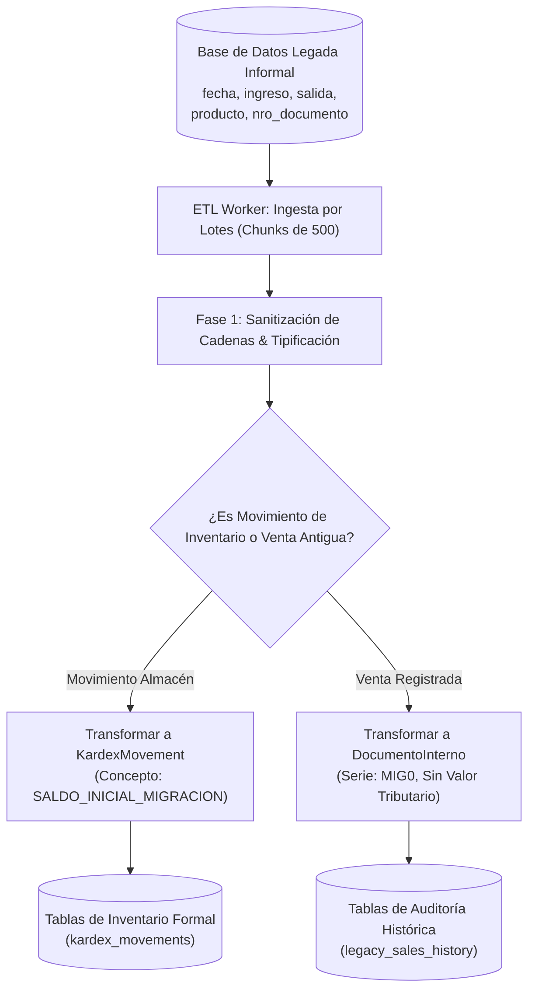
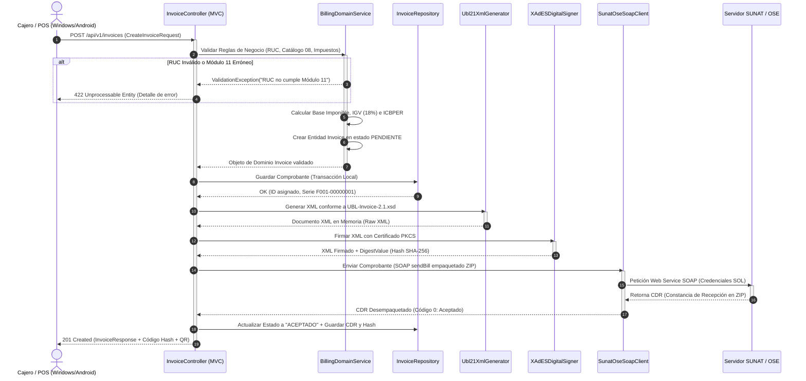
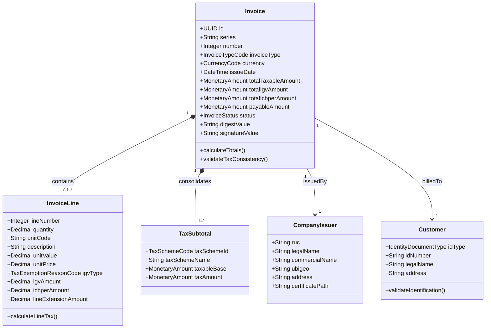
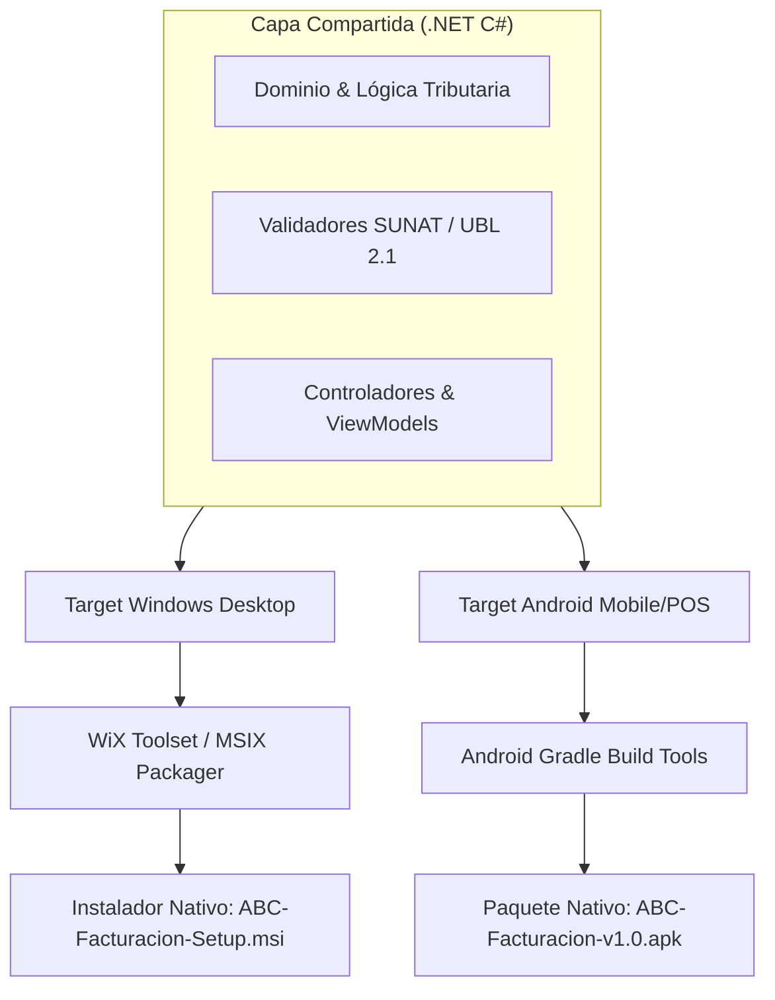

#ALUMNO: Salazar Ramos Jhordy Antonio

# DOCUMENTO DE ESPECIFICACIÓN TÉCNICA Y ARQUITECTURA (SPEC-FIRST)
## Sistema de Facturación Electrónica UBL 2.1 y Migración Legada
**Cliente:** ABC Software Corp  
**Materia:** Arquitectura de Software — Examen de Medio Curso  
**Metodología:** Spec-First Architecture (API & Domain First)  
**Marco Legal y Normativo:** RS Nº 097-2012 / RS Nº 234-2006 / Estándar OASIS UBL 2.1 (`UBL-Invoice-2.1.xsd`)  

---

## 1. Resumen Ejecutivo y Metodología Spec-First

### 1.1 Contexto del Negocio
**ABC Software Corp** es una empresa comercializadora de abarrotes y mercadería al por mayor y menor. Opera con un software de control de almacén informal con datos elementales (`fecha`, `ingreso`, `salida`, `producto`, `nro_documento`).

Frente a la exigencia tributaria de la **SUNAT** (Superintendencia Nacional de Aduanas y de Administración Tributaria), la empresa requiere modernizar su plataforma para emitir comprobantes de pago electrónicos con valor legal estructurados bajo el estándar internacional **UBL 2.1 (Universal Business Language)** y validaciones del marco de Operadores de Servicios Electrónicos (OSE) / SUNAT.

### 1.2 Enfoque Metodológico: Spec-First
Siguiendo las directrices de la gerencia y de la cátedra de arquitectura, se aplica la metodología **Spec-First**:
1. **Modelado formal de contratos y reglas** antes de escribir código de infraestructura o lógica de negocio.
2. **Definición de validaciones tributarias** como reglas de dominio invariantes (algoritmo Módulo 11 para RUC, cálculo de base imponible y Catálogo 08 de la SUNAT).
3. **Desacoplamiento arquitectónico**: Comenzar con un Monolito Limpio bajo el patrón **MVC**, estructurado de tal modo que sus capas internas operen como Puertos y Adaptadores (**Arquitectura Hexagonal**), garantizando una transición inmediata a microservicios a medida que la empresa escale.

---

## 2. Análisis del Sistema Legado y «Nuestra Data»

### 2.1 Diagnóstico de Brechas de la Data Informal

| Campo Legado | Tipo Actual | Limitación Crítica en el Sistema Legado | Requerimiento SUNAT / UBL 2.1 |
| :--- | :--- | :--- | :--- |
| `fecha` | Texto o fecha simple | No tiene zona horaria ni hora de emisión legal; no valida plazo de 3 días hábiles para envío a SUNAT. | `cbc:IssueDate` (YYYY-MM-DD) y `cbc:IssueTime` (HH:MM:SS) bajo UTC-5. |
| `ingreso` | Numérico informal | No discrimina si es compra formal, devolución, traslado entre sucursales o ajuste de merma. | Tipo de Operación formal (Catálogo 51: `0101` Venta Interna, `02` Compra Nacional) y Kardex valorizado. |
| `salida` | Numérico informal | No separa valor venta de impuestos ni discrimina tipo de comprobante. | Cantidad tipificada con unidad de medida internacional (Catálogo 03: `NIU` Unidad, `KGM` Kilos). |
| `producto` | Texto libre | Nombres ambiguos sin SKU, sin catálogo de tributos ni discriminación si lleva bolsa plástica (ICBPER). | Código interno único, código Sunat opcional (UNSPSC) y tributos asociados del Catálogo 08. |
| `nro_documento` | Entero correlativo libre | No cumple formato legal de Serie (`F001`, `B001`) y Correlativo de 8 dígitos. No valida RUC del cliente. | Serie alfanumérica de 4 dígitos + Correlativo numérico de 8 dígitos (`cbc:ID`). |

---

### 2.2 Diccionario de Datos Formal («Nuestra Data» Normalizada)

Este diccionario define el estándar que gobernará las bases de datos y DTOs del nuevo sistema:

| Nombre del Campo | Tipo de Dato | Long. | Nulo | Restricción / Validación Normativa | Descripción Funcional |
| :--- | :---: | :---: | :---: | :--- | :--- |
| `invoice_id` | UUID | 36 | NO | Clave primaria inmutable | Identificador global del comprobante en la plataforma. |
| `tipo_comprobante` | VARCHAR | 2 | NO | Catálogo 01 (`01`=Factura, `03`=Boleta, `07`=NC, `08`=ND) | Tipo legal del comprobante de pago electrónico. |
| `serie` | VARCHAR | 4 | NO | Regex: `^[F\|B][A-Z0-9]{3}$` (Ej: `F001`, `B001`) | Serie asignada por establecimiento/caja. |
| `correlativo` | INT | 8 | NO | Rango: 1 a 99,999,999. Autoincremental por serie | Número correlativo del comprobante. |
| `fecha_emision` | DATE | 10 | NO | Formato ISO 8601 (`YYYY-MM-DD`). Máx 3 días hacia atrás | Fecha fiscal de la transacción. |
| `hora_emision` | TIME | 8 | NO | Formato ISO 8601 (`HH:MM:SS`) | Hora oficial de la transacción. |
| `moneda` | VARCHAR | 3 | NO | Catálogo 02 (`PEN`, `USD`) | Código ISO 4217 de la divisa de la transacción. |
| `emisor_ruc` | VARCHAR | 11 | NO | Numérico, empieza en `20` o `10`. Validación Módulo 11 | RUC de ABC Software Corp. |
| `cliente_tipo_doc` | VARCHAR | 1 | NO | Catálogo 06 (`6`=RUC, `1`=DNI, `4`=Carnet Ext., `7`=Pasaporte) | Tipo de identificación del comprador. |
| `cliente_num_doc` | VARCHAR | 15 | NO | Si tipo=6: 11 dígitos con Módulo 11. Si tipo=1: 8 dígitos | Número de documento fiscal del cliente. |
| `cliente_razon_social`| VARCHAR | 250 | NO | Mínimo 3 caracteres. Caracteres especiales sanitizados | Nombre o razón social del cliente. |
| `item_codigo` | VARCHAR | 30 | NO | Alfanumérico único por producto | SKU interno de la mercadería o abarrotes. |
| `item_descripcion` | VARCHAR | 500 | NO | Texto claro sin caracteres no XML (`&`, `<`, `>`) | Nombre comercial del producto vendido. |
| `item_unidad_medida` | VARCHAR | 3 | NO | Catálogo 03 (`NIU`=Unidad, `KGM`=Kilogramos, `BX`=Caja) | Unidad de medida internacional. |
| `item_cantidad` | DECIMAL | (12,3)| NO | Mayor a 0.000 | Cantidad despachada del producto. |
| `item_valor_unitario` | DECIMAL | (12,4)| NO | Mayor o igual a 0.0000 (sin impuestos) | Valor monetario del producto sin incluir IGV. |
| `item_precio_unitario`| DECIMAL | (12,4)| NO | Mayor o igual a 0.0000 (con impuestos) | Precio final al consumidor por unidad de medida. |
| `tipo_afectacion_igv` | VARCHAR | 2 | NO | Catálogo 07 (`10`=Gravado Oneroso, `20`=Exonerado, `30`=Inafecto) | Régimen tributario aplicable a la línea. |
| `codigo_tributo` | VARCHAR | 4 | NO | **Catálogo 08** (`1000`=IGV, `7152`=ICBPER, `9997`=Exonerado) | Código internacional del tributo gravado. |
| `igv_monto` | DECIMAL | (12,2)| NO | Si afectación=10: `item_valor_unitario * cantidad * 0.18` | Monto del Impuesto General a las Ventas. |
| `icbper_monto` | DECIMAL | (12,2)| NO | `cantidad_bolsas * 0.50` (si aplica) | Impuesto al Consumo de las Bolsas de Plástico. |
| `importe_total` | DECIMAL | (12,2)| NO | `total_valor_venta + total_igv + total_icbper` | Importe total a pagar por el cliente. |
| `hash_firma` | VARCHAR | 100 | SÍ | Hash SHA-256 codificado en Base64 | Resumen digital del XML firmado legalmente. |
| `cdr_estado` | VARCHAR | 20 | SÍ | `PENDIENTE`, `ACEPTADO`, `RECHAZADO`, `OBSERVADO` | Estado retornado por SUNAT/OSE en el CDR. |

---

### 2.3 Estrategia de Migración de Datos Legados

Para preservar el histórico del almacén informal sin contaminar el modelo tributario formal:



---

## 3. Casos de Uso del Negocio (Benchmarking con Nubefact / Entornos Reales)

A continuación se detallan los casos de uso críticos en formato tabular formal con precondiciones, flujos y excepciones normativas:

### Caso de Uso CU-01: Emitir Factura Electrónica B2B

| Atributo | Detalle de la Especificación |
| :--- | :--- |
| **Identificador** | **CU-01** |
| **Nombre** | **Emisión de Factura Electrónica Comercial (B2B)** |
| **Actor Principal** | Vendedor / Cajero de ABC Software Corp |
| **Precondiciones** | 1. El cliente debe contar con número de RUC de 11 dígitos válido.<br>2. El emisor debe tener certificado digital PKCS#12 vigente.<br>3. Al menos un ítem debe haber sido agregado al carrito de venta. |
| **Flujo Principal (Happy Path)** | 1. El vendedor ingresa el número de RUC del cliente.<br>2. El sistema valida el dígito verificador (Módulo 11) y consulta el estado del RUC en padrón (debe estar `ACTIVO` y `HABIDO`).<br>3. El vendedor ingresa los ítems de mercadería.<br>4. El sistema calcula la base imponible y el IGV (18%) conforme a las reglas del Catálogo 08.<br>5. El sistema asigna el correlativo siguiente para la serie `F001`.<br>6. Se genera el documento de dominio `Invoice` y se guarda en base de datos local con estado `PENDIENTE_ENVIO`.<br>7. El sistema construye el XML bajo `UBL-Invoice-2.1.xsd`, aplica la firma digital XAdES-BES y lo envía al Web Service SOAP de SUNAT/OSE.<br>8. SUNAT responde con el archivo CDR (Constancia de Recepción) con código `0` (Aceptado).<br>9. Se genera el ticket de impresión con código QR y se entrega al cliente. |
| **Flujos Alternativos / Excepciones** | **E1 (RUC Inválido / No Habido):** El sistema bloquea la emisión de factura y sugiere emitir Boleta de Venta o solicitar actualización de datos fiscales.<br>**E2 (SUNAT Rechaza Comprobante):** Si el CDR retorna un código de error (ej: `2017` - Comprobante ya existe), la factura pasa a estado `RECHAZADA` con el detalle del error y no se entrega comprobante legal.<br>**E3 (Tiempo de espera agotado - Timeout SUNAT):** Si el Web Service no responde en 5 segundos, la factura queda en estado `EN_COLA_REINTENTO` (Modo Contingencia CU-04). |
| **Postcondición** | Comprobante emitido, inventario descontado, XML y CDR almacenados con valor legal tributario. |

---

### Caso de Uso CU-02: Emitir Boleta de Venta Rápida B2C (Mostrador)

| Atributo | Detalle de la Especificación |
| :--- | :--- |
| **Identificador** | **CU-02** |
| **Nombre** | **Emisión de Boleta de Venta Rápida en Mostrador (B2C)** |
| **Actor Principal** | Cajero de Punto de Venta |
| **Precondiciones** | La caja de mostrador debe estar abierta y con serie asignada (ej: `B001`). |
| **Flujo Principal** | 1. El cajero escanea los códigos de barra de los abarrotes.<br>2. Si el monto total es menor a S/ 700.00, el cajero puede emitir con cliente `VARIOS` (sin identificar DNI).<br>3. Si el monto supera los S/ 700.00, el sistema exige obligatoriamente ingresar el DNI del cliente (Catálogo 06: `1`).<br>4. El sistema calcula los totales desglosando base imponible e IGV.<br>5. Se guarda la boleta con serie `B001-xxxxxxxx`, se sella localmente y se imprime el comprobante de venta de inmediato para no demorar la fila. |
| **Flujos Alternativos / Excepciones** | **E1 (Monto > S/ 700 sin DNI):** El sistema deshabilita el botón de cobro hasta que se registre un documento de identidad válido de 8 dígitos según normativa de SUNAT. |
| **Postcondición** | Boleta registrada, stock descontado, lista para ser enviada de forma individual o mediante Resumen Diario de Boletas (RC). |

---

### Caso de Uso CU-03: Venta de Abarrotes con Impuesto a las Bolsas Plásticas (ICBPER)

| Atributo | Detalle de la Especificación |
| :--- | :--- |
| **Identificador** | **CU-03** |
| **Nombre** | **Cálculo y Facturación del Impuesto ICBPER (Catálogo 08 - Tributo 7152)** |
| **Actor Principal** | Cajero |
| **Precondiciones** | El cliente solicita bolsas plásticas para empacar su compra de abarrotes. |
| **Flujo Principal** | 1. El cajero agrega los productos convencionales gravados con IGV (18%).<br>2. El cajero presiona la tecla de función para agregar bolsas plásticas (ejemplo: 3 unidades).<br>3. El sistema identifica el producto bolsa plástica y aplica la regla especial de tributo **ICBPER (Código `7152`)**:<br>   - Valor unitario comercial de la bolsa (ej: S/ 0.10 + IGV).<br>   - Impuesto fijo ICBPER por unidad = S/ 0.50.<br>4. El sistema adiciona a la base del ICBPER: $3 \times 0.50 = \text{S/ } 1.50$.<br>5. El total del comprobante suma la mercadería, el IGV y el monto total de ICBPER.<br>6. En el XML UBL 2.1 se crea un nodo `cac:TaxTotal` exclusivo con `cac:TaxScheme/cbc:ID = 7152` y nombre `ICBPER`. |
| **Flujos Alternativos / Excepciones** | **E1 (Bolsa Biodegradable no gravada):** Si la empresa utiliza bolsas certificadas compostables/biodegradables, el flag `aplica_icbper` se desactiva y solo se cobra el costo regular con IGV. |
| **Postcondición** | La liquidación del impuesto ICBPER queda separada para la declaración mensual en el formulario Declara Fácil de SUNAT. |

---

### Caso de Uso CU-04: Emisión en Modo Offline / Cola de Contingencia

| Atributo | Detalle de la Especificación |
| :--- | :--- |
| **Identificador** | **CU-04** |
| **Nombre** | **Emisión de Comprobantes en Modo Offline (Caída de Internet o SUNAT)** |
| **Actor Principal** | Sistema / Cajero |
| **Precondiciones** | Pérdida de conexión a internet o caída del servicio web de la OSE/SUNAT durante la venta. |
| **Flujo Principal** | 1. El cajero procede con la venta regular.<br>2. El servicio de comunicación detecta fallo de conexión (Connection Timeout / Socket Exception).<br>3. El sistema activa el **Circuito de Aislamiento (Circuit Breaker)** y cambia al modo local offline.<br>4. Se firma el XML localmente con el certificado digital instalado en el equipo del almacén.<br>5. Se genera el código Hash SHA-256 y el código QR oficial.<br>6. Se imprime el ticket con la leyenda legal: *"Comprobante emitido en contingencia según normativa SUNAT"*.<br>7. El comprobante se almacena en la tabla local `invoice_dispatch_queue` con estado `PENDIENTE_SINCRONIZAR`.<br>8. Un servicio en segundo plano (Background Worker) monitorea la reconexión y transmite los comprobantes pendientes dentro del plazo legal de 3 días calendario. |
| **Flujos Alternativos / Excepciones** | **E1 (Rechazo posterior por SUNAT):** Si al recuperar la conexión un comprobante es observado, el administrador del sistema recibe una alerta inmediata en el panel de control. |
| **Postcondición** | La venta no se detiene en tienda y se garantiza el cumplimiento del despacho continuo. |

---

### Caso de Uso CU-05: Emisión de Nota de Crédito Electrónica

| Atributo | Detalle de la Especificación |
| :--- | :--- |
| **Identificador** | **CU-05** |
| **Nombre** | **Emisión de Nota de Crédito por Devolución o Anulación (Catálogo 09)** |
| **Actor Principal** | Supervisor de Tienda / Administrador |
| **Precondiciones** | La factura o boleta de referencia debe existir en el sistema y haber sido aceptada por SUNAT. |
| **Flujo Principal** | 1. El supervisor localiza la factura original (ej: `F001-00000120`).<br>2. Selecciona el motivo de emisión según el Catálogo 09 de SUNAT (ej: `01` Anulación de la operación, `07` Devolución total).<br>3. El sistema asigna serie `FC01` (para Facturas) o `BC01` (para Boletas).<br>4. Se asocian los nodos UBL `cac:BillingReference` vinculando el UUID y número de la factura original.<br>5. Se firma y transmite a SUNAT.<br>6. El sistema actualiza el stock devolviendo la mercadería al almacén (reverso de kardex). |
| **Postcondición** | Factura referenciada queda anulada/ajustada y el stock físico reingresado. |

---

### Caso de Uso CU-06: Migración e Ingesta de Lotes de Datos Legados

| Atributo | Detalle de la Especificación |
| :--- | :--- |
| **Identificador** | **CU-06** |
| **Nombre** | **Ingesta y Conciliación de Movimientos Históricos del Almacén** |
| **Actor Principal** | Ingeniero de Migración / Administrador |
| **Precondiciones** | Archivo CSV o volcado SQL de la base de datos informal antigua (`fecha`, `ingreso`, `salida`, `producto`, `nro_documento`). |
| **Flujo Principal** | 1. El administrador carga el archivo legado a través del endpoint `/api/v1/migration/legacy-stock`.<br>2. El pipeline ETL procesa los registros en lotes (chunks) de 500 registros para no bloquear la memoria.<br>3. Se limpian descripciones nulas y se genera un catálogo de productos con SKU estandarizado.<br>4. Se calcula el saldo neto ($\sum \text{ingresos} - \sum \text{salidas}$) para cada producto.<br>5. Se crea una transacción de apertura de inventario formal.<br>6. Se genera un reporte de auditoría con los registros migrados exitosamente y los rechazados por inconsistencia. |
| **Postcondición** | Saldo inicial de abarrotes conciliado en el nuevo sistema sin pérdida de trazabilidad contable. |

---

## 4. Diagramas de Arquitectura UML

### 4.1 Diagrama de Secuencia UML: Emisión, Firma y Transmisión con OSE/SUNAT

Este diagrama describe el ciclo de vida completo de una transacción desde la interfaz de usuario hasta la obtención del CDR:



---

### 4.2 Diagrama de Clases UML del Dominio



---

## 5. Estructura de Carpetas Física del Proyecto (MVC Desacoplado a Hexagonal)

Para cumplir con la directriz de gerencia de **construir un monolito limpio bajo el patrón MVC, pero desacoplado para evolucionar a Arquitectura Hexagonal y Microservicios**, la estructura de carpetas física se organiza de forma que las carpetas del código reflejen exactamente los **Puertos y Adaptadores**:

```text
abc-billing-solution/
├── src/
│   ├── ABC.Billing.Core/                           # NÚCLEO HEXAGONAL (Lógica de Dominio Pura)
│   │   ├── Domain/
│   │   │   ├── Entities/                           # Entidades del Negocio
│   │   │   │   ├── Invoice.cs
│   │   │   │   ├── InvoiceLine.cs
│   │   │   │   ├── Customer.cs
│   │   │   │   └── TaxSubtotal.cs
│   │   │   ├── ValueObjects/                       # Objetos de Valor Inmutables
│   │   │   │   ├── RucNumber.cs                    # Validación Módulo 11
│   │   │   │   ├── Money.cs
│   │   │   │   └── DocumentSeries.cs
│   │   │   ├── Enums/                              # Catálogos SUNAT tipificados
│   │   │   │   ├── TipoComprobante.cs              # Catálogo 01
│   │   │   │   ├── TipoMoneda.cs                   # Catálogo 02
│   │   │   │   ├── TipoDocumentoIdentidad.cs       # Catálogo 06
│   │   │   │   ├── AfectacionIgv.cs                # Catálogo 07
│   │   │   │   └── CodigoTributo.cs                # Catálogo 08 (1000, 7152, 9997)
│   │   │   └── Services/                           # Servicios de Dominio
│   │   │       ├── TaxCalculatorService.cs         # Fórmulas de cálculo IGV e ICBPER
│   │   │       └── RucValidatorService.cs
│   │   │
│   │   └── Ports/                                  # CONTRATOS E INTERFACES (PUERTOS)
│   │       ├── Inbound/                            # Casos de Uso (Puertos de Entrada)
│   │       │   ├── IEmitirFacturaUseCase.cs
│   │       │   ├── IConsultarCdrUseCase.cs
│   │       │   └── IMigrarDatosLegadosUseCase.cs
│   │       └── Outbound/                           # Puertos de Salida (Infraestructura Desacoplada)
│   │           ├── IInvoiceRepository.cs           # Puerto para persistencia SQL
│   │           ├── IUblXmlGenerator.cs             # Puerto para generación XSD UBL 2.1
│   │           ├── IDigitalSigner.cs               # Puerto para firma digital XAdES-BES
│   │           ├── ISunatOseClient.cs              # Puerto para Web Service SOAP
│   │           └── ILegacyDataSource.cs            # Puerto para extracción del sistema informal
│   │
│   ├── ABC.Billing.Infrastructure/                 # ADAPTADORES DE SALIDA (Driven Adapters)
│   │   ├── Persistence/
│   │   │   ├── Sqlite/                             # Base de datos embebida para Windows/Android
│   │   │   ├── Repositories/
│   │   │   │   └── SqlInvoiceRepository.cs
│   │   │   └── Migrations/
│   │   │       └── LegacyAuditMappingConfig.cs
│   │   ├── UblEngine/                              # Adaptador UBL 2.1
│   │   │   ├── Serializers/
│   │   │   │   └── UblInvoice21XmlSerializer.cs    # Mapeo a UBL-Invoice-2.1.xsd
│   │   │   └── Schemas/
│   │   │       └── UBL-Invoice-2.1.xsd
│   │   ├── Cryptography/                           # Adaptador de Firma Digital
│   │   │   └── XadesBesCertificateSigner.cs        # Implementación con Certificado PKCS#12
│   │   └── SunatSoap/                              # Adaptador Web Services SUNAT
│   │       ├── SunatSoapWsClient.cs                # Cliente SOAP con seguridad WS-Security
│   │       └── CdrZipExtractor.cs                  # Desempaquetador de constancias de recepción
│   │
│   ├── ABC.Billing.Presentation.Api/               # CONTROLADORES MVC (API REST / Endpoints)
│   │   ├── Controllers/
│   │   │   ├── InvoicesController.cs               # POST /api/v1/invoices
│   │   │   ├── CdrController.cs                    # GET /api/v1/invoices/{id}/cdr
│   │   │   └── MigrationController.cs              # POST /api/v1/migration/legacy-stock
│   │   └── DTOs/
│   │       ├── Requests/
│   │       │   ├── CreateInvoiceRequest.cs
│   │       │   └── LegacyMigrationBatchRequest.cs
│   │       └── Responses/
│   │           ├── InvoiceResponse.cs
│   │           └── CdrResponse.cs
│   │
│   └── ABC.Billing.App.Client/                     # VISTAS MVC / UI MULTIPLATAFORMA (.NET MAUI)
│       ├── Views/                                  # Interfaz gráfica (XAML / MVVM)
│       │   ├── PosBillingPage.xaml                 # Vista Mostrador (Caja rápida)
│       │   ├── InvoiceHistoryPage.xaml             # Vista Historial de facturas y CDR
│       │   └── MigrationToolPage.xaml              # Vista Asistente de Migración de almacén
│       ├── ViewModels/                             # Controladores de Vista
│       └── Platforms/
│           ├── Windows/                            # Código nativo empaquetable a instalador MSI
│           └── Android/                            # Código nativo empaquetable a APK móvil
│
├── packaging/                                      # EMPAQUETADO MULTIPLATAFORMA
│   ├── windows-msi/
│   │   ├── Product.wxs                             # Script de compilación WiX Toolset para MSI
│   │   └── installer_config.json
│   └── android-apk/
│       ├── AndroidManifest.xml
│       └── build.gradle
│
├── docs/                                           # DOCUMENTACIÓN Y SPECS
│   ├── openapi-spec.yaml                           # Contrato OpenAPI 3.0
│   ├── UBL-Invoice-2.1.xsd                         # Esquema oficial OASIS
│   └── ESPECIFICACION_TECNICA_UBL_ABC.md          # Este documento
└── README.md
```

---

## 6. Especificación de Endpoints / Servicios (Contratos API)

A continuación se define la especificación bajo estándar **OpenAPI 3.0**:

```yaml
openapi: 3.0.3
info:
  title: ABC Software Corp - Facturación Electrónica UBL 2.1
  description: API de emisión, validación y envío de comprobantes electrónicos a SUNAT.
  version: 1.0.0
paths:
  /api/v1/invoices:
    post:
      summary: Crear y validar comprobante electrónico
      description: Recibe los datos de venta, aplica reglas tributarias, valida RUC y almacena el comprobante.
      requestBody:
        required: true
        content:
          application/json:
            schema:
              $ref: '#/components/schemas/CreateInvoiceRequest'
      responses:
        '201':
          description: Comprobante creado exitosamente
          content:
            application/json:
              schema:
                $ref: '#/components/schemas/InvoiceResponse'
        '422':
          description: Error de validación fiscal o de datos (RUC inválido, catálogo no conforme)

  /api/v1/invoices/{id}/xml:
    post:
      summary: Generar XML estructurado UBL 2.1
      parameters:
        - name: id
          in: path
          required: true
          schema:
            type: string
            format: uuid
      responses:
        '200':
          description: XML generado conforme a UBL-Invoice-2.1.xsd
          content:
            application/xml:
              schema:
                type: string

  /api/v1/invoices/{id}/transmit:
    post:
      summary: Firmar y transmitir a OSE / SUNAT
      description: Aplica firma XAdES-BES, empaqueta en ZIP y envía al Web Service SOAP de SUNAT/OSE.
      parameters:
        - name: id
          in: path
          required: true
          schema:
            type: string
            format: uuid
      responses:
        '200':
          description: Comprobante procesado por SUNAT (con CDR)
          content:
            application/json:
              schema:
                $ref: '#/components/schemas/CdrResponse'

  /api/v1/migration/legacy-stock:
    post:
      summary: Ingesta de datos del software legado
      description: Procesa lotes de movimientos históricos (fecha, ingreso, salida, producto, nro_documento).
      requestBody:
        required: true
        content:
          application/json:
            schema:
              type: array
              items:
                $ref: '#/components/schemas/LegacyMovementItem'
      responses:
        '200':
          description: Migración ejecutada con informe de trazabilidad
```

---

## 7. Matriz de Trazabilidad Normativa: SUNAT vs UBL 2.1

Esta matriz cruza las exigencias de la **RS Nº 097-2012** y normas conexas con la estructura **OASIS UBL 2.1** (`UBL-Invoice-2.1.xsd`), con especial énfasis en el **Catálogo 08 de la SUNAT**.

### 7.1 Mapeo de Catálogos Tributarios a Nodos UBL 2.1

| Concepto Normativo SUNAT | Catálogo SUNAT | Valor Ejemplo | Ruta en UBL 2.1 (`UBL-Invoice-2.1.xsd`) |
| :--- | :--- | :--- | :--- |
| **Tipo de Comprobante** | Catálogo 01 | `01` (Factura) | `/Invoice/cbc:InvoiceTypeCode` |
| **Moneda** | Catálogo 02 | `PEN` (Soles) | `/Invoice/cbc:DocumentCurrencyCode` |
| **Tipo Documento Identidad** | Catálogo 06 | `6` (RUC), `1` (DNI) | `.../cac:AccountingCustomerParty/cac:Party/cac:PartyIdentification/cbc:ID[@schemeID='6']` |
| **Afectación al IGV** | Catálogo 07 | `10` (Gravado - Op. Onerosa) | `.../cac:InvoiceLine/cac:TaxTotal/cac:TaxSubtotal/cac:TaxCategory/cbc:TaxExemptionReasonCode` |
| **Sistema Tributario (Punto Clave)** | **Catálogo 08** | **`1000` (IGV)**<br>**`7152` (ICBPER)**<br>**`9997` (Exonerado)** | **`.../cac:TaxSubtotal/cac:TaxCategory/cac:TaxScheme/cbc:ID`**<br>**`.../cac:TaxSubtotal/cac:TaxCategory/cac:TaxScheme/cbc:Name`** |
| **Serie y Correlativo** | R.S. 097-2012 | `F001-00000001` | `/Invoice/cbc:ID` |
| **Fecha de Emisión** | R.S. 097-2012 | `2026-10-22` | `/Invoice/cbc:IssueDate` |
| **Firma Digital** | R.S. 097-2012 | XAdES-BES PKCS#12 | `/Invoice/ext:UBLExtensions/ext:UBLExtension/.../ds:Signature` |

### 7.2 Detalle del Catálogo 08 de SUNAT (Códigos de Tributos en UBL 2.1)

El **Catálogo 08** tipifica el tipo de tributo aplicado a la línea o al resumen global del comprobante:

| Código Tributo | Nombre Oficial (SUNAT) | Código Internacional UBL (UN/ECE 5153) | Ubicación en XML UBL 2.1 |
| :---: | :---: | :---: | :--- |
| **`1000`** | **IGV - Impuesto General a las Ventas** | `VAT` | `cac:TaxScheme/cbc:ID` = `1000`<br>`cac:TaxScheme/cbc:Name` = `IGV`<br>`cac:TaxScheme/cbc:TaxTypeCode` = `VAT` |
| **`2000`** | **ISC - Impuesto Selectivo al Consumo** | `EXC` | `cac:TaxScheme/cbc:ID` = `2000`<br>`cac:TaxScheme/cbc:Name` = `ISC` |
| **`7152`** | **ICBPER - Impuesto a la Bolsa Plástica** | `OTH` | `cac:TaxScheme/cbc:ID` = `7152`<br>`cac:TaxScheme/cbc:Name` = `ICBPER`<br>`cac:TaxScheme/cbc:TaxTypeCode` = `OTH` |
| **`9997`** | **Exonerado - Transferencia Gratuita** | `VAT` | `cac:TaxScheme/cbc:ID` = `9997`<br>`cac:TaxScheme/cbc:Name` = `EXO` |
| **`9998`** | **Inafecto - Operación Inafecta** | `FRE` | `cac:TaxScheme/cbc:ID` = `9998`<br>`cac:TaxScheme/cbc:Name` = `INA` |

---

## 8. Distribución y Multiplataforma: Windows (MSI) y Android (APK)

Para satisfacer la restricción técnica de ejecución nativa en **Windows de escritorio** y **dispositivos móviles Android**:



### Justificación de Tecnología
* **Framework Seleccionado:** **.NET MAUI** (Multi-platform App UI).
* **Motivo:** Permite compartir el 100% de la lógica de dominio (cálculos de IGV, validación de Módulo 11 y serializadores XML) entre plataformas, generando un instalador **`.msi`** para terminales de caja de escritorio en Windows y un paquete **`.apk`** para terminales POS portátiles en almacén bajo Android.
