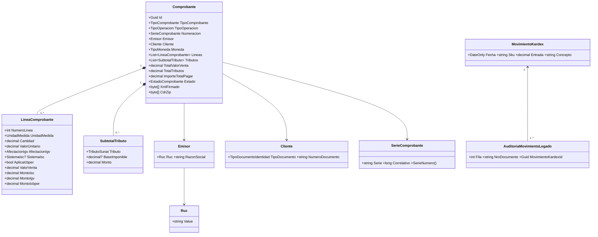
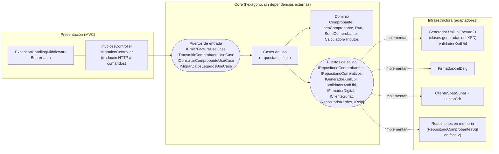
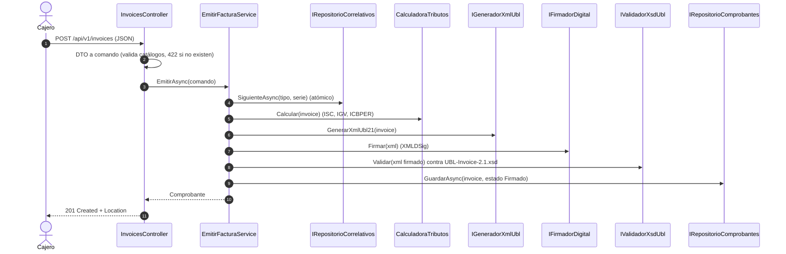

# Especificación técnica Spec-First: Sistema de facturación electrónica de ABC Software Corp (UBL 2.1 / SUNAT)

> **Alumno:** Salazar Ramos, Jhordy Antonio  
> **Curso:** Arquitectura de Software (UNAS) · **Examen de medio curso:** 19/10/2026 · **Versión del documento:** 2.0 (corregida con las observaciones del profesor)  
> **Entregable:** esqueleto de especificaciones técnicas de la fase 1 (Spec-First): modelo de dominio y contratos, diagramas MVC con visión Hexagonal, contratos API y matriz de trazabilidad normativa.

## 1. Resumen y alcance

### 1.1 Objetivo

ABC Software Corp comercializa abarrotes y mercadería al por mayor y menor. Su software actual solo registra fichas simples (`fecha`, `ingreso`, `salida`, `producto`, `nro_documento`). SUNAT exige emitir comprobantes electrónicos en XML bajo el estándar UBL, **firmados digitalmente** y enviados a SUNAT o a un OSE. Este documento define las reglas, los contratos de datos, las validaciones y los contratos de interfaz **antes** de escribir lógica de negocio, y documenta el código de referencia que acompaña a la especificación.

### 1.2 Fuentes normativas y técnicas usadas

| Fuente | Qué aporta | Dónde se usa |
|:---|:---|:---|
| Manual del Programador SEE – Sistemas del Contribuyente (SUNAT, mayo 2021) | Nombres de archivo y ZIP, WebService SOAP (`sendBill`, `sendSummary`, `sendPack`, `getStatus`, `getStatusCdr`), WS-Security, firma XMLDSig, CDR, rangos de códigos de error, contingencia | Secciones 9, 10 y 11 |
| Anexo N.° 8 – Catálogo de códigos (RS 097-2012/SUNAT y modificatorias; versión del Anexo VII de la RS 117-2017) | Catálogos 01 a 25 y 51 a 58 | Sección 3 |
| RS 150-2019/SUNAT (anexos) | Actualización del Catálogo 05 (IVAP 1016 e ICBPER 7152) y XML del ICBPER | Secciones 3, 7 y 10 |
| Guía de elaboración de documentos electrónicos XML, Factura UBL 2.1 (SUNAT) | Contenido y ubicación de cada campo en UBL 2.1, regla del IGV | Secciones 7, 10 y 11 |
| `UBL-Invoice-2.1.xsd` (OASIS, paquete UBL 2.1) | Esquema oficial contra el que se valida el XML | Sección 10 |
| Anexo 1 de la RS 361-2015/SUNAT (estructura del formato 14.1 del PLE) | Campos del Registro de Ventas e Ingresos | Sección 11.5 |
| RS 042-2018/SUNAT (estructura del formato 12.1 del PLE) | Campos del Registro de Inventario Permanente en Unidades Físicas | Secciones 4 y 11.6 |

### 1.3 Estado de implementación

Esta especificación distingue lo que **ya existe en el código** de este repositorio de lo que solo está **especificado** (contrato definido, implementación pendiente).

- [x] Dominio: catálogos 01, 02, 03, 05, 06, 07, 08, 09, 10, 16, 51 y 52, `Ruc` (Módulo 11), `SerieComprobante`, `NombreArchivoSunat`
- [x] Cálculo tributario: ISC → IGV, ICBPER, exonerado, inafecto, exportación y operaciones gratuitas
- [x] Clases UBL **generadas desde `UBL-Invoice-2.1.xsd`** (614 clases, herramienta propia en `tools/`)
- [x] Emisión: serie y correlativo atómicos, XML UBL 2.1, firma XMLDSig, validación contra el XSD oficial
- [x] **Pruebas unitarias xUnit de generación** (153 pruebas en `tests/ABC.Billing.Tests`)
- [x] Dominio expresado en español: `Comprobante`, `LineaComprobante`, `SubtotalTributo`, `Cliente`, `Emisor`...
- [x] Transmisión `sendBill` (cliente SOAP), lectura del CDR, estados y contingencia
- [x] Migración del sistema legado al kardex con auditoría
- [x] API: `POST/GET /invoices`, `/xml`, `/transmit`, `/cdr` y `POST /migration/legacy-stock`, con autenticación Bearer y errores `application/problem+json`
- [x] Contrato OpenAPI 3.0.3 completo y validado ([`openapi.yaml`](openapi.yaml))
- [ ] Notas de crédito y débito (`cac:BillingReference`), comunicación de baja (RA) y resumen diario de boletas (RC): **contrato definido, código pendiente**
- [ ] Sistema de ISC 03 (precio de venta al público) e IVAP: requieren el Apéndice IV del T.U.O. del IGV e ISC; el código los rechaza con un error explícito
- [ ] Adaptador SQL (`RepositorioComprobantesSql`): esquema propuesto en [`sql/001_schema.sql`](sql/001_schema.sql); hoy se usa un repositorio en memoria
- [ ] Aplicación cliente MAUI (Windows y Android) y empaquetado MSI/APK: especificados en la sección 12, no compilados
- [ ] Pruebas contra el servicio beta de SUNAT: el cliente SOAP se escribió según el manual y se probó con un CDR de ejemplo, no contra el servicio real

### 1.4 Cambios respecto de la versión anterior

| Observación del profesor | Corrección | Dónde |
|:---|:---|:---|
| Se usó "Catálogo 08" para los códigos de tributo (1000, 2000, 7152, 9997...) | Esos códigos son del **Catálogo 05**. El **Catálogo 08** es únicamente el sistema de cálculo del ISC (`cbc:TierRange`). Además se aclara que "Anexo 8" es el conjunto de catálogos | 3.1 a 3.5, 7, 10, 11 |
| El XML se armaba con `StringBuilder` | Clases **generadas desde el XSD oficial** (`tools/ABC.Billing.GenerarClasesUbl`), serializadas con `XmlSerializer` (escape automático), salida en ISO-8859-1, validación contra el mismo XSD | 10 |
| El XML no tenía emisor ni líneas, y un `TaxTotal` por tributo | `AccountingSupplierParty`, `LineaComprobante` por ítem (con su `TaxTotal`) y **un solo** `TaxTotal` de cabecera con varios `TaxSubtotal` | 10.2 |
| `LineExtensionAmount` solo sumaba las gravadas | Suma el valor de venta de **todas** las operaciones onerosas (gravadas, exoneradas, inafectas y exportación) | 7.1 |
| No se calculaba el ISC | ISC primero (sistemas 01 y 02), IGV sobre (valor de venta + ISC) | 7.1 |
| Regex de serie `[F|B]` aceptaba `|`; serie y correlativo por defecto `F001-1` | `^[FB][A-Z0-9]{3}$`; el correlativo lo asigna el servidor de forma atómica; F para facturas y B para boletas | 6.2, 8.4 |
| El controlador calculaba impuestos | El controlador solo traduce DTO a comando; todo el flujo vive en el caso de uso | 8 |
| Pocos endpoints, YAML incompleto, sin seguridad | 13 operaciones, OpenAPI validado con schemas, `bearerAuth` y todos los códigos HTTP, mapeadas a los métodos SUNAT | 9 |
| Faltaban los formatos 14.1 y 12.1 en la matriz | Secciones 11.5 y 11.6, con el cruce campo por campo | 11 |
| Se afirmaba que `UnidadMedida` era un `string` libre | Enum del Catálogo 03 validado en el mapeador | 6.3 |
| Archivos de la estructura de carpetas inexistentes | El árbol de la sección 8.4 se generó a partir de los archivos reales | 8.4 |

### 1.5 Taller 2: generar el XML de la factura desde el XSD

| Requisito del profesor | Dónde se cumple |
|:---|:---|
| Generar el XML de la factura a partir del `UBL-Invoice-2.1.xsd` oficial de OASIS | Las clases de [`UblInvoice21.generated.cs`](../src/ABC.Billing.Infrastructure/UblEngine/Generado/UblInvoice21.generated.cs) se **generan desde el XSD** con `tools/ABC.Billing.GenerarClasesUbl`; `GeneradorXmlUblFactura21` las llena y serializa, y el resultado se valida contra el mismo XSD (sección 10.6) |
| En el lenguaje del dominio | El dominio habla de comprobantes, líneas, tributos y clientes (`Comprobante`, `LineaComprobante`, `SubtotalTributo`, `Cliente`). Las etiquetas UBL solo existen en el adaptador de Infraestructura; lo comprueban las pruebas de `AislamientoDelDominioTests` |
| Pruebas unitarias de generación | [`tests/ABC.Billing.Tests`](../tests/ABC.Billing.Tests) (xUnit), carpeta `Generacion/`: 58 pruebas de estructura, catálogos, importes, escape, codificación, XSD, firma y fidelidad con el XSD |
| Fecha límite 12/11/2026 (el profesor clona el repositorio, que es público) | El repositorio compila y prueba tras clonarlo: `git clone` y `dotnet test` (ver `README.md`) |

## 2. Estándar y versiones

- La **factura, boleta y notas** usan **UBL 2.1** (`UBL-Invoice-2.1.xsd`): `cbc:UBLVersionID = 2.1` y `cbc:CustomizationID = 2.0` (la personalización peruana).
- La **Constancia de Recepción (CDR)** que devuelve SUNAT es un `ApplicationResponse` con su estructura propia: `UBLVersionID = 2.0` y `CustomizationID = 1.0` (Manual del Programador, Anexo 1).
- El Manual del Programador (mayo 2021) todavía dice "UBL 2.0" en su texto introductorio. Se toma de él el **procedimiento** (envío, firma, nombres, CDR, errores) y la **estructura del documento** se toma del XSD 2.1 y de la guía UBL 2.1.
- En UBL 2.1 los totales de impuestos van en `cac:TaxTotal` y `cac:LegalMonetaryTotal`, no en las extensiones `sac:AdditionalMonetaryTotal` del esquema anterior.

## 3. Catálogos SUNAT (Anexo N.° 8)

### 3.1 "Anexo 8" no es lo mismo que "Catálogo 08"

El enunciado del examen habla del "catálogo 8 de SUNAT". En la normativa hay dos cosas distintas con ese número, y este documento las trata por separado:

| Término | Qué es | Contenido |
|:---|:---|:---|
| **Anexo N.° 8** (RS 097-2012/SUNAT y modificatorias) | El **conjunto** de catálogos de códigos | Catálogos 01 al 25 y 51 al 58 |
| **Catálogo N.° 08** | Un catálogo **dentro** del Anexo 8 | Tipos de **sistema de cálculo del ISC** |

Por eso el dominio usa tres enums distintos y nunca mezcla códigos entre ellos:

```csharp
TributoSunat.Igv.Codigo        // "1000"  -> Catálogo 05
AfectacionIgv.GravadoOperacionOnerosa  // 10 -> Catálogo 07
SistemaIsc.AlValor             // 1  ("01") -> Catálogo 08
```

### 3.2 Catálogos usados y dónde aparecen en el XML

| Catálogo | Contenido | Campo UBL 2.1 | Tipo en el código |
|:---|:---|:---|:---|
| 01 | Tipo de documento (01 factura, 03 boleta, 07 nota de crédito, 08 nota de débito) | `cbc:InvoiceTypeCode` | `TipoComprobante` |
| 02 | Moneda (ISO 4217) | `cbc:DocumentCurrencyCode` | `TipoMoneda` |
| 03 | Unidad de medida (UN/ECE Rec. 20) | `cbc:InvoicedQuantity/@unitCode` | `UnidadMedida` |
| **05** | **Tipos de tributo** | `cac:TaxScheme/cbc:ID`, `Name`, `TaxTypeCode` | `TributoSunat` |
| 06 | Tipo de documento de identidad | `cbc:CompanyID/@schemeID` | `TipoDocumentoIdentidad` |
| 07 | Afectación al IGV | `cbc:TaxExemptionReasonCode` | `AfectacionIgv` |
| **08** | **Sistema de cálculo del ISC** | `cbc:TierRange` | `SistemaIsc` |
| 09 y 10 | Motivo de nota de crédito y de débito | `cbc:ResponseCode` | `TipoNotaCredito`, `TipoNotaDebito` |
| 16 | Tipo de precio de venta unitario | `cbc:PriceTypeCode` | `TipoPrecio` |
| 25 | Código de producto SUNAT (UNSPSC) | `cac:CommodityClassification` | pendiente |
| 51 | Tipo de operación de la factura | `cbc:ProfileID` | `TipoOperacion` |
| 52 | Leyendas | `cbc:Note/@languageLocaleID` | `Leyenda` |

### 3.3 Catálogo 05: tipos de tributo

| Código | Nombre (`cbc:Name`) | `TaxTypeCode` | Categoría UN/ECE 5305 | Uso |
|:---|:---|:---|:---|:---|
| 1000 | IGV | VAT | S | Impuesto General a las Ventas |
| 1016 | IVAP | VAT | S | Arroz pilado (no soportado en esta fase) |
| 2000 | ISC | EXC | S | Impuesto Selectivo al Consumo |
| **7152** | **ICBPER** | OTH | S | Impuesto al consumo de las bolsas de plástico (RS 150-2019) |
| 9995 | EXP | FRE | G | Exportación |
| **9996** | GRA | FRE | Z | Operaciones gratuitas |
| **9997** | EXO | VAT | E | Exonerado (**oneroso**; las transferencias gratuitas van en 9996) |
| 9998 | INA | FRE | O | Inafecto |
| 9999 | OTROS | OTH | S | Otros conceptos de pago |

### 3.4 Catálogo 07: afectación al IGV

| Código | Descripción | Categoría en el código | Tributo (Cat. 05) |
|:---|:---|:---|:---|
| 10 | Gravado: operación onerosa | GravadoOneroso | 1000 |
| 11 a 16 | Gravado: retiro por premio, donación, retiro, publicidad, bonificaciones, entrega a trabajadores | GravadoGratuito | 9996 (con IGV informativo) |
| 17 | Gravado: IVAP | Ivap | 1016 (no soportado) |
| 20 | Exonerado: operación onerosa | ExoneradoOneroso | 9997 |
| 21 | Exonerado: transferencia gratuita | ExoneradoGratuito | 9996 |
| 30 | Inafecto: operación onerosa | InafectoOneroso | 9998 |
| 31 a 36 | Inafecto: retiros (bonificación, retiro, muestras médicas, convenio colectivo, premio, publicidad) | InafectoGratuito | 9996 |
| 40 | Exportación | Exportacion | 9995 |

### 3.5 Catálogo 08: sistema de cálculo del ISC

| Código | Descripción | Estado en el código | Fórmula usada |
|:---|:---|:---|:---|
| 01 | Sistema al valor (Apéndice IV, lit. A del T.U.O. IGV e ISC) | Implementado | `ISC = valor de venta × tasa / 100` |
| 02 | Monto fijo (lit. B) | Implementado | `ISC = cantidad × monto fijo` |
| 03 | Precio de venta al público (lit. C) | **Rechazado con error 422** | Requiere el Apéndice IV, literal C |

## 4. Sistema legado y migración de datos

### 4.1 Mapeo de los campos legados

El software básico guarda cinco campos por movimiento. Ninguno se pierde: cada fila original queda en una tabla de auditoría enlazada al kardex.

| Campo legado | Entidad nueva | Destino | Regla |
|:---|:---|:---|:---|
| `fecha` | `MovimientoKardex.Fecha` y `AuditoriaMovimientoLegado.Fecha` | formato 12.1, campo 10 | Se acepta `dd/MM/yyyy` o `yyyy-MM-dd`; una fecha imposible (31/02) se reporta como error de esa fila |
| `ingreso` | `MovimientoKardex.Entrada` | formato 12.1, campo 17 | `>= 0` |
| `salida` | `AuditoriaMovimientoLegado.Salida` (y se descuenta del saldo) | formato 12.1, campo 18 | `>= 0`; no puede dejar saldo negativo |
| `producto` | `MovimientoKardex.Sku` y `DescripcionExistencia` | formato 12.1, campos 7 y 15 | Se normaliza (espacios y mayúsculas) y recibe un SKU estable `MIG-000001` |
| `nro_documento` | `AuditoriaMovimientoLegado.NroDocumento` | formato 12.1, campos 12 y 13 | Se conserva tal cual para la trazabilidad |

### 4.2 Estrategia

1. Los movimientos históricos **no se facturan**: no se generan comprobantes electrónicos para ellos.
2. Por cada producto se crea **un** movimiento `SALDO_INICIAL_MIGRACION` con el saldo (`Σ ingreso − Σ salida`). En el formato 12.1, la primera tupla corresponde al saldo inicial.
3. Cada fila original queda en `migracion_legado_auditoria`, con el `Sku` y el `MovimientoKardexId` al que contribuyó.
4. Un producto con saldo negativo no se migra: sus filas se reportan con el mensaje "concilie el stock antes de migrar".
5. El resultado devuelve totales, saldos por producto y errores por número de fila.

Ejemplo ejecutado en las pruebas (6 filas): 3 migradas y 3 con error, con `ARROZ EXTRA = 100 − 30 = 70`.

## 5. Casos de uso

| Id | Caso de uso | Actor | Método SUNAT | Endpoint | Estado |
|:---|:---|:---|:---|:---|:---|
| CU-01 | Emitir factura | Cajero | (previo a `sendBill`) | `POST /api/v1/invoices` | Implementado |
| CU-02 | Emitir boleta de venta | Cajero | (previo a resumen) | `POST /api/v1/invoices` con tipo `03` | Implementado |
| CU-03 | Calcular impuestos: ISC, IGV y ICBPER | Sistema | | (dentro de CU-01 y CU-02) | Implementado |
| CU-04 | Transmitir a SUNAT/OSE y recibir CDR | Sistema | `sendBill` | `POST /api/v1/invoices/{id}/transmit` | Implementado |
| CU-05 | Consultar comprobante y descargar XML y CDR | Cajero, Auditor | `getStatusCdr` | `GET /api/v1/invoices/{id}`, `/xml`, `/cdr` | Implementado |
| CU-06 | Migrar datos del sistema legado | Administrador | | `POST /api/v1/migration/legacy-stock` | Implementado |
| CU-07 | Emitir nota de crédito o de débito | Cajero | `sendBill` | `POST /api/v1/credit-notes`, `/debit-notes` | Contrato |
| CU-08 | Comunicación de baja (RA) | Administrador | `sendSummary` + `getStatus` | `POST /api/v1/voided-documents` | Contrato |
| CU-09 | Resumen diario de boletas (RC) | Sistema | `sendSummary` + `getStatus` | `POST /api/v1/daily-summaries` | Contrato |

### 5.1 CU-01: Emitir factura (flujo principal)

1. El cajero envía tipo `01`, tipo de operación (Catálogo 51), cliente con RUC válido (Módulo 11) e ítems con su afectación al IGV (Catálogo 07).
2. El sistema valida cada código contra su catálogo y devuelve **422** si alguno no existe.
3. Asigna la serie (`F001` por defecto o la solicitada) y el **correlativo de forma atómica**.
4. Calcula ISC, IGV, ICBPER y los totales (sección 7).
5. Genera el XML UBL 2.1, lo firma (XMLDSig) y lo valida contra `UBL-Invoice-2.1.xsd`.
6. Guarda el comprobante en estado `Firmado` y responde **201** con `Location`.

**Flujos alternos**

| Condición | Resultado |
|:---|:---|
| Cliente sin RUC en una factura (salvo exportación) | 422 |
| Serie `B001` en una factura | 422 |
| ICBPER con cantidad no entera | 422 |
| Sistema de ISC 03 | 422 (no soportado en esta fase) |
| El XML no cumple el XSD | 422 con la lista de errores |

### 5.2 CU-04: Transmitir a SUNAT

| Resultado de SUNAT | Estado del comprobante | HTTP |
|:---|:---|:---|
| CDR con `ResponseCode` 0 y sin notas | `Aceptado` | 200 |
| CDR con código 0 y notas (códigos 4000+) | `AceptadoConObservaciones` | 200 |
| CDR con código de rechazo (2000 a 3999) | `Rechazado` (la numeración queda consumida; se emite uno nuevo) | 200 |
| SOAP Fault (excepción, el documento queda como no informado) | sin cambio | 502 |
| SUNAT/OSE no disponible | `EnContingencia` (cola de reintento, XML firmado intacto) | 202 |
| Comprobante ya aceptado o rechazado | sin cambio | 409 |

## 6. Modelo de dominio y contratos (DTO y Schemas)

### 6.1 Modelo de dominio



### 6.2 Value Objects y reglas de validación

| Value Object | Regla | Fuente |
|:---|:---|:---|
| `Ruc` | 11 dígitos, prefijo 10, 15, 17 o 20, dígito verificador Módulo 11 | SUNAT |
| `SerieComprobante` | Serie `^[FB][A-Z0-9]{3}$` (F factura, B boleta); correlativo de 1 a 8 dígitos desde 1; `SerieNumero = F001-1` es el `cbc:ID` | Manual del Programador 1.2 |
| `NombreArchivoSunat` | `RUC-TT-SERIE-CORRELATIVO` (comprobantes), `RUC-RA-YYYYMMDD-CCCCC` (baja), `RUC-RC-YYYYMMDD-CCCCC` (resumen). El ZIP y el XML comparten nombre | Manual del Programador 1.2 |
| `Cliente` | RUC con Módulo 11, DNI de 8 dígitos, CE o pasaporte alfanumérico de hasta 12 | Catálogo 06 |
| `TributoSunat` | Registro inmutable con código, nombre, código internacional y categoría UN/ECE 5305 | Catálogo 05 |

### 6.3 DTO de entrada: `CreateInvoiceRequest`

Los catálogos viajan con su código SUNAT en texto. El mapeador los traduce a enums y rechaza lo que no pertenezca al catálogo (422).

| Campo | Tipo | Requerido | Catálogo o regla |
|:---|:---|:---|:---|
| `tipoComprobante` | string | Sí | 01 (`"01"` o `"03"`) |
| `tipoOperacion` | string | No (`"0101"`) | 51 |
| `serie` | string | No | `^[FB][A-Z0-9]{3}$`. **El correlativo nunca se envía** |
| `moneda` | string | No (`PEN`) | 02 |
| `cliente.tipoDocumento` | string | Sí | 06 |
| `cliente.numeroDocumento` | string | Sí | Según el tipo (máx. 15) |
| `cliente.razonSocial` | string | Sí | Máx. 250 |
| `items[].unidadMedida` | string | Sí | 03 (`NIU`, `KGM`, `LTR`...) |
| `items[].cantidad` | number | Sí | `> 0` |
| `items[].valorUnitario` | number | Sí | `> 0`, sin impuestos |
| `items[].afectacionIgv` | string | Sí | 07 |
| `items[].sistemaIsc` | string | No | **08** (solo ISC) |
| `items[].tasaIsc` | number | No | `%` para el sistema 01 |
| `items[].montoFijoIsc` | number | No | Para el sistema 02 |
| `items[].aplicaIcbper` | boolean | No | Bolsa de plástico; cantidad entera |

```json
{
  "tipoComprobante": "01",
  "tipoOperacion": "0101",
  "moneda": "PEN",
  "cliente": { "tipoDocumento": "6", "numeroDocumento": "20123456786", "razonSocial": "BODEGA EL ÑANDÚ S.A.C." },
  "items": [
    { "codigoProducto": "ARR-5KG", "descripcion": "Arroz extra 5 kg", "unidadMedida": "NIU", "cantidad": 10, "valorUnitario": 18.00, "afectacionIgv": "10" },
    { "codigoProducto": "CER-620", "descripcion": "Cerveza 620 ml", "unidadMedida": "NIU", "cantidad": 6, "valorUnitario": 5.00, "afectacionIgv": "10", "sistemaIsc": "01", "tasaIsc": 10 },
    { "codigoProducto": "BOL-PLA", "descripcion": "Bolsa de plástico", "unidadMedida": "NIU", "cantidad": 3, "valorUnitario": 0.10, "afectacionIgv": "10", "aplicaIcbper": true }
  ]
}
```

La respuesta (`InvoiceResponse`) incluye `totales`, `tributos` (con código del Catálogo 05), `items`, `estado`, `digestValue` y, tras el envío, el `cdr`. El esquema completo está en [`openapi.yaml`](openapi.yaml).

## 7. Reglas de cálculo tributario

### 7.1 Orden y fórmulas

El orden lo fija la guía UBL 2.1 de SUNAT: primero el ISC y después el IGV, porque la base del IGV es el valor de venta más el ISC. El ICBPER se cobra aparte y no forma parte de esa base.

| Concepto | Fórmula |
|:---|:---|
| Valor de venta del ítem | `R2(cantidad × valor unitario)` |
| ISC, sistema 01 (al valor) | `R2(valor de venta × tasa / 100)` |
| ISC, sistema 02 (monto fijo) | `R2(cantidad × monto fijo)` |
| Base del IGV | `valor de venta + ISC` |
| IGV (gravado oneroso) | `R2(base del IGV × 0.18)` |
| ICBPER | `R2(cantidad de bolsas × tarifa por bolsa)` (tarifa configurable; 0.50 en las pruebas) |
| Operación gratuita | valor referencial; su IGV (si es gravada, códigos 11 a 16) es **informativo** y no se cobra |
| `LineExtensionAmount` (total valor de venta) | gravadas + exoneradas + inafectas + exportación |
| `TaxTotal/TaxAmount` | IGV + ISC + ICBPER (excluye el IGV de gratuitas) |
| `TaxInclusiveAmount` (precio de venta) | valor de venta + IGV + ISC + ICBPER |
| `PayableAmount` (importe a pagar) | igual al precio de venta (sin descuentos ni anticipos en esta fase) |

`R2` redondea a 2 decimales con `MidpointRounding.AwayFromZero`. El IGV total es la suma de los IGV por línea, y se verifica que coincida con `18 % × (gravadas + ISC)`.

### 7.2 Ejemplo verificado

Es el mismo caso que ejecutan las pruebas automáticas (sección 13); la cerveza usa una tasa de ISC de prueba del 10 %.

| N.° | Descripción | Afectación (Cat. 07) | Cant. | V. unit. | Valor de venta | ISC | Base IGV | IGV | ICBPER |
|:---|:---|:---|---:|---:|---:|---:|---:|---:|---:|
| 1 | Arroz extra 5 kg | 10 | 10 | 18.00 | 180.00 | | 180.00 | 32.40 | |
| 2 | Cerveza (ISC sistema 01, 10 %) | 10 | 6 | 5.00 | 30.00 | 3.00 | 33.00 | 5.94 | |
| 3 | Quinua exonerada | 20 | 5 | 12.00 | 60.00 | | | | |
| 4 | Sal inafecta | 30 | 2 | 4.00 | 8.00 | | | | |
| 5 | Bolsa de plástico | 10 | 3 | 0.10 | 0.30 | | 0.30 | 0.05 | 1.50 |
| 6 | Muestra gratuita | 11 | 1 | 20.00 (ref.) | 0.00 | | 20.00 | 3.60 (informativo) | |

| Total | Importe |
|:---|---:|
| Operaciones gravadas (sin ISC) | 210.30 |
| ISC | 3.00 |
| Base imponible del IGV (210.30 + 3.00) | 213.30 |
| IGV (18 % de 213.30) | 38.39 |
| Exoneradas / inafectas | 60.00 / 8.00 |
| ICBPER (3 bolsas × 0.50) | 1.50 |
| Gratuitas (valor referencial) | 20.00 |
| **Total valor de venta** (`LineExtensionAmount`) | **278.30** |
| `TaxTotal/TaxAmount` (38.39 + 3.00 + 1.50) | 42.89 |
| **Precio de venta e importe a pagar** (278.30 + 42.89) | **321.19** |

La leyenda 1000 resulta: `SON: TRESCIENTOS VEINTIUNO Y 19/100 SOLES`.

### 7.3 Supuestos y límites

- La base imponible del formato 14.1 no incluye el ISC (nota 4 del anexo), coherente con que `OperacionesGravadas` excluya el ISC.
- Las operaciones gratuitas se informan con `LineExtensionAmount = 0.00` y `Price = 0.00`; el valor referencial va en `PricingReference` con tipo de precio 02. Este tratamiento sigue la práctica habitual de los OSE y debe cotejarse con el ejemplo de transferencia gratuita de la guía antes de producción.
- No se modelan descuentos, cargos ni anticipos (`cac:AllowanceCharge`, `cac:PrepaidPayment`): quedan como trabajo futuro.

## 8. Arquitectura: MVC hoy, Hexagonal mañana

### 8.1 Decisión

El sistema se construye como un **monolito MVC limpio** y su núcleo se aísla en un **hexágono** (puertos y adaptadores), de modo que migrar a Clean Architecture o a microservicios sea mover adaptadores, no reescribir reglas. Las capas se ven así:



La regla de dependencia es: **Presentación → Core ← Infraestructura**. El Core no referencia ASP.NET, ni SOAP, ni criptografía, ni almacenamiento.

### 8.2 Puertos, adaptadores y ruta a microservicios

| Puerto (Core) | Adaptador actual | Adaptador futuro | Microservicio candidato |
|:---|:---|:---|:---|
| `IGeneradorXmlUbl` + `IValidadorXsdUbl` | `GeneradorXmlUblFactura21`, `ValidadorXsdUbl` | Mismo código empaquetado como servicio | **Servicio de documentos UBL** |
| `IFirmadorDigital` | `FirmadorXmlDsig` (certificado en archivo) | HSM o almacén de certificados | **Servicio de firma** |
| `IClienteSunat` | `ClienteSoapSunat` (SOAP) | Cliente de otro OSE; cola de reintentos | **Servicio de integración SUNAT/OSE** |
| `IRepositorioComprobantes`, `IRepositorioCorrelativos` | `RepositorioComprobantesEnMemoria`, `RepositorioCorrelativosEnMemoria` | `RepositorioComprobantesSql` (esquema en [`sql/001_schema.sql`](sql/001_schema.sql)) | **Servicio de comprobantes** |
| `IRepositorioKardex` | `RepositorioKardexEnMemoria` | SQL | **Servicio de inventario** |
| `IReloj` | `RelojPeru` (UTC−5) | Reloj de prueba | n/a |

Cuando la empresa crezca, cada fila se separa como proceso independiente: el caso de uso deja de llamar al adaptador en memoria y llama a un cliente HTTP o a un bus de mensajes que implementa **el mismo puerto**. El dominio y los casos de uso no cambian.

### 8.3 Flujo de emisión (el controlador no calcula)



### 8.4 Estructura de carpetas

La estructura se generó a partir de los archivos del repositorio; solo aparece lo que existe.

```text
abc-billing-solution/
├── docs/
│   ├── ejemplos/
│   │   ├── boleta-ejemplo-firmada.xml
│   │   ├── envio-ejemplo.zip
│   │   └── factura-ejemplo-firmada.xml
│   ├── sql/
│   │   └── 001_schema.sql
│   ├── ESPECIFICACION_TECNICA_UBL_ABC.md
│   └── openapi.yaml
├── packaging/
│   ├── android-apk/
│   │   └── build.gradle
│   └── windows-msi/
│       └── Product.wxs
├── src/
│   ├── ABC.Billing.App.Client/
│   │   ├── Views/
│   │   │   └── PosBillingPage.xaml.cs
│   │   └── README.md
│   ├── ABC.Billing.Core/
│   │   ├── Application/
│   │   │   ├── Commands/
│   │   │   │   └── EmitirFacturaCommand.cs
│   │   │   └── UseCases/
│   │   │       ├── ConsultarComprobanteService.cs
│   │   │       ├── EmitirFacturaService.cs
│   │   │       ├── MigrarDatosLegadosService.cs
│   │   │       └── TransmitirComprobanteService.cs
│   │   ├── Domain/
│   │   │   ├── Entities/
│   │   │   │   ├── Cliente.cs
│   │   │   │   ├── Comprobante.cs
│   │   │   │   ├── Emisor.cs
│   │   │   │   ├── LineaComprobante.cs
│   │   │   │   ├── MovimientoKardex.cs
│   │   │   │   └── SubtotalTributo.cs
│   │   │   ├── Enums/
│   │   │   │   ├── Catalogos.cs
│   │   │   │   └── TributoSunat.cs
│   │   │   ├── Services/
│   │   │   │   ├── CalculadoraTributos.cs
│   │   │   │   ├── ClasificadorCodigosSunat.cs
│   │   │   │   └── MontoEnLetras.cs
│   │   │   ├── ValueObjects/
│   │   │   │   ├── NombreArchivoSunat.cs
│   │   │   │   ├── Ruc.cs
│   │   │   │   └── SerieComprobante.cs
│   │   │   └── DomainExceptions.cs
│   │   ├── Ports/
│   │   │   ├── Inbound/
│   │   │   │   ├── IConsultarComprobanteUseCase.cs
│   │   │   │   ├── IEmitirFacturaUseCase.cs
│   │   │   │   ├── IMigrarDatosLegadosUseCase.cs
│   │   │   │   └── ITransmitirComprobanteUseCase.cs
│   │   │   └── Outbound/
│   │   │       ├── IClienteSunat.cs
│   │   │       ├── IFirmadorDigital.cs
│   │   │       ├── IGeneradorXmlUbl.cs
│   │   │       ├── IReloj.cs
│   │   │       ├── IRepositorioComprobantes.cs
│   │   │       ├── IRepositorioCorrelativos.cs
│   │   │       ├── IRepositorioKardex.cs
│   │   │       └── IValidadorXsdUbl.cs
│   │   └── ABC.Billing.Core.csproj
│   ├── ABC.Billing.Infrastructure/
│   │   ├── Cryptography/
│   │   │   ├── CertificadoDePrueba.cs
│   │   │   └── FirmadorXmlDsig.cs
│   │   ├── Persistence/
│   │   │   ├── InMemory/
│   │   │   │   └── RepositoriosEnMemoria.cs
│   │   │   └── Repositories/
│   │   │       └── RepositorioComprobantesSql.cs
│   │   ├── SunatSoap/
│   │   │   ├── ClienteSoapSunat.cs
│   │   │   └── LectorCdr.cs
│   │   ├── UblEngine/
│   │   │   ├── Generacion/
│   │   │   │   ├── GeneradorXmlUblFactura21.cs
│   │   │   │   └── ValidadorXsdUbl.cs
│   │   │   ├── Generado/
│   │   │   │   └── UblInvoice21.generated.cs
│   │   │   ├── Schemas/   (XSD oficiales de OASIS UBL 2.1: maindoc/ y common/)
│   │   │   └── UblNamespaces.cs
│   │   └── ABC.Billing.Infrastructure.csproj
│   └── ABC.Billing.Presentation.Api/
│       ├── Controllers/
│       │   ├── InvoicesController.cs
│       │   └── MigrationController.cs
│       ├── DTOs/
│       │   ├── Requests/
│       │   │   └── CreateInvoiceRequest.cs
│       │   ├── Responses/
│       │   │   └── Responses.cs
│       │   └── InvoiceRequestMapper.cs
│       ├── Middleware/
│       │   └── ExceptionHandlingMiddleware.cs
│       ├── Security/
│       │   └── BearerTokenAuthHandler.cs
│       ├── ABC.Billing.Presentation.Api.csproj
│       ├── appsettings.Development.json
│       ├── appsettings.json
│       └── Program.cs
├── tests/
│   └── ABC.Billing.Tests/
│       ├── Aplicacion/
│       │   ├── EmisionDeComprobantesTests.cs
│       │   ├── MigracionDeDatosLegadosTests.cs
│       │   └── TransmisionDeComprobantesTests.cs
│       ├── Dominio/
│       │   ├── AislamientoDelDominioTests.cs
│       │   ├── CalculoTributosTests.cs
│       │   └── ValoresDelDominioTests.cs
│       ├── Generacion/
│       │   ├── FirmaDigitalTests.cs
│       │   ├── GeneracionDesdeXsdTests.cs
│       │   ├── GeneracionXmlTests.cs
│       │   └── ValidacionXsdTests.cs
│       ├── Infraestructura/
│       │   └── ClienteSunatTests.cs
│       ├── Soporte/
│       │   └── Fabrica.cs
│       └── ABC.Billing.Tests.csproj
├── tools/
│   ├── ABC.Billing.GenerarClasesUbl/
│   │   ├── ABC.Billing.GenerarClasesUbl.csproj
│   │   └── Program.cs
│   ├── ABC.Billing.GenerarEjemplos/
│   │   ├── ABC.Billing.GenerarEjemplos.csproj
│   │   └── Program.cs
│   └── README.md
├── .gitignore
├── ABC.Billing.sln
└── README.md
```

## 9. Contratos de API

El contrato completo y validado (OpenAPI 3.0.3) está en [`openapi.yaml`](openapi.yaml). Cada operación declara `x-implementation` (`implemented` o `contract`) y `x-sunat` (método SOAP que la respalda).

### 9.1 Endpoints

| Método y ruta | Operación | Método SUNAT | Roles | Respuestas | Estado |
|:---|:---|:---|:---|:---|:---|
| `POST /api/v1/invoices` | Emitir factura o boleta | | emisor | 201, 400, 401, 403, 422 | Implementado |
| `GET /api/v1/invoices` | Listar (serie, estado, fechas) | | emisor | 200, 400, 401, 403 | Implementado |
| `GET /api/v1/invoices/{id}` | Obtener | | emisor | 200, 401, 403, 404 | Implementado |
| `GET /api/v1/invoices/{id}/xml` | Descargar XML firmado | | emisor | 200, 401, 403, 404, 409 | Implementado |
| `POST /api/v1/invoices/{id}/transmit` | Enviar a SUNAT/OSE | `sendBill` | emisor | 200, 202, 401, 403, 404, 409, 502 | Implementado |
| `GET /api/v1/invoices/{id}/cdr` | Descargar CDR | `getStatusCdr` | emisor | 200, 401, 403, 404 | Implementado |
| `POST /api/v1/credit-notes` | Nota de crédito (07) | `sendBill` | emisor | 201, 400, 401, 403, 404, 422 | Contrato |
| `POST /api/v1/debit-notes` | Nota de débito (08) | `sendBill` | emisor | 201, 400, 401, 403, 404, 422 | Contrato |
| `POST /api/v1/voided-documents` | Comunicación de baja (RA) | `sendSummary` | emisor | 202, 400, 401, 403, 422, 502, 503 | Contrato |
| `POST /api/v1/daily-summaries` | Resumen diario de boletas (RC) | `sendSummary` | emisor | 202, 400, 401, 403, 422, 502, 503 | Contrato |
| `GET /api/v1/tickets/{ticket}` | Estado del ticket (0, 98, 99) | `getStatus` | emisor | 200, 401, 403, 404, 502, 503 | Contrato |
| `POST /api/v1/migration/legacy-stock` | Migrar stock legado | | admin | 200, 400, 401, 403, 422 | Implementado |
| `GET /api/v1/catalogs/{catalogo}` | Valores de un catálogo | | emisor | 200, 401, 403, 404 | Contrato |

### 9.2 Códigos HTTP y su origen

| HTTP | Causa | Excepción del Core |
|:---|:---|:---|
| 400 | JSON mal formado, campos obligatorios o rangos incumplidos | validación del modelo |
| 401 | Falta el token Bearer o es inválido | |
| 403 | El token no tiene el rol (la migración exige `admin`) | |
| 404 | El comprobante no existe, o aún no hay CDR | `NoEncontradoException` |
| 409 | Comprobante ya aceptado, rechazado o sin XML firmado | `ConflictoException` |
| 422 | Regla de negocio o de catálogo, RUC inválido, XML que no cumple el XSD | `DominioValidationException`, `UblValidationException` |
| 502 | SUNAT respondió con un SOAP Fault | `SunatExcepcionException` |
| 503 | SUNAT/OSE no disponible | `SunatNoDisponibleException` |
| 500 | Error inesperado (sin detalles internos al cliente) | cualquier otra |

Todos los errores usan `application/problem+json` (RFC 7807).

### 9.3 Mapeo de los códigos de respuesta de SUNAT (Manual 4.1)

| Rango | Tipo | Efecto en el sistema |
|:---|:---|:---|
| 0 | Aceptado | `Aceptado` (o `AceptadoConObservaciones` si trae notas) |
| 0100 a 0999 | Excepción de SUNAT | El documento queda como no informado: se puede reenviar (HTTP 502) |
| 1000 a 1999 | Excepción del contribuyente (formato o estructura) | Igual: corregir y reenviar |
| 2000 a 3999 | Error que genera rechazo | `Rechazado`: la numeración queda usada; se emite un comprobante nuevo |
| 4000 en adelante | Observación | `AceptadoConObservaciones`; las notas se guardan |

### 9.4 Seguridad

- Esquema `bearerAuth` (HTTP Bearer). Los tokens se leen de configuración (`Auth:EmisorToken`, `Auth:AdminToken`) y se comparan en tiempo constante. **Fuera de Desarrollo la aplicación no arranca si no están configurados.**
- Roles: `emisor` (comprobantes) y `admin` (migración; también puede emitir).
- Es una autenticación mínima para esta fase. En producción se reemplaza por JWT (OAuth2/OIDC) cambiando solo el esquema registrado en `Program.cs`.
- Hacia SUNAT: WS-Security `UsernameToken` con `Username = RUC + usuario SOL` y la clave SOL como contraseña, sobre HTTPS. La clave SOL debe ser secundaria y con el perfil de envío de documentos electrónicos (Manual 2.2).
- La clave SOL y la contraseña del certificado no se guardan en el repositorio: se pasan por variables de entorno.

## 10. XML UBL 2.1 firmado

### 10.1 Estructura generada

Orden de los elementos del `Comprobante` (sigue la secuencia del XSD):

| N.° | Elemento | Contenido |
|:---|:---|:---|
| 1 | `ext:UBLExtensions` | Una `UBLExtension` con `ExtensionContent`, donde va `ds:Signature` |
| 2 a 4 | `cbc:UBLVersionID`, `cbc:CustomizationID`, `cbc:ProfileID` | `2.1`, `2.0`, tipo de operación (Catálogo 51) |
| 5 a 8 | `cbc:ID`, `IssueDate`, `IssueTime`, `InvoiceTypeCode` | `F001-1`, fecha, hora, `01` |
| 9 | `cbc:Note` | Leyenda 1000 (monto en letras); 1002 si todo es gratuito |
| 10 | `cbc:DocumentCurrencyCode` | `PEN` |
| 11 | `cac:Signature` | Referencia `#SignABC` a la firma |
| 12 y 13 | `cac:AccountingSupplierParty`, `cac:AccountingCustomerParty` | Emisor y adquirente |
| 14 | `cac:TaxTotal` | **Uno solo**, con un `TaxSubtotal` por tributo |
| 15 | `cac:LegalMonetaryTotal` | `LineExtensionAmount`, `TaxInclusiveAmount`, `PayableAmount` |
| 16 | `cac:InvoiceLine` (1..n) | Ítem con su `TaxTotal`, precio y producto |

### 10.2 Extractos del XML real generado

Extractos del archivo [`ejemplos/factura-ejemplo-firmada.xml`](ejemplos/factura-ejemplo-firmada.xml) (se omiten algunos atributos de catálogo para que se lea mejor). Línea con **ISC (Catálogo 08 en `TierRange`) y luego IGV**:

```xml
<cac:TaxTotal>
  <cbc:TaxAmount currencyID="PEN">8.94</cbc:TaxAmount>
  <cac:TaxSubtotal>
    <cbc:TaxableAmount currencyID="PEN">30.00</cbc:TaxableAmount>
    <cbc:TaxAmount currencyID="PEN">3.00</cbc:TaxAmount>
    <cac:TaxCategory>
      <cbc:ID schemeID="UN/ECE 5305" schemeName="Tax Category Identifier" schemeAgencyName="United Nations Economic Commission for Europe">S</cbc:ID>
      <cbc:Percent>10.00</cbc:Percent>
      <cbc:TierRange>01</cbc:TierRange>
      <cac:TaxScheme>
        <cbc:ID schemeName="Codigo de tributos" schemeAgencyName="PE:SUNAT" schemeURI="urn:pe:gob:sunat:cpe:see:gem:catalogos:catalogo05">2000</cbc:ID>
        <cbc:Name>ISC</cbc:Name>
        <cbc:TaxTypeCode>EXC</cbc:TaxTypeCode>
      </cac:TaxScheme>
    </cac:TaxCategory>
  </cac:TaxSubtotal>
  <cac:TaxSubtotal>
    <cbc:TaxableAmount currencyID="PEN">33.00</cbc:TaxableAmount>
    <cbc:TaxAmount currencyID="PEN">5.94</cbc:TaxAmount>
    <cac:TaxCategory>
      <cbc:ID schemeID="UN/ECE 5305" schemeName="Tax Category Identifier" schemeAgencyName="United Nations Economic Commission for Europe">S</cbc:ID>
      <cbc:Percent>18.00</cbc:Percent>
      <cbc:TaxExemptionReasonCode listName="Afectacion del IGV" listAgencyName="PE:SUNAT" listURI="urn:pe:gob:sunat:cpe:see:gem:catalogos:catalogo07">10</cbc:TaxExemptionReasonCode>
      <cac:TaxScheme>
        <cbc:ID schemeName="Codigo de tributos" schemeAgencyName="PE:SUNAT" schemeURI="urn:pe:gob:sunat:cpe:see:gem:catalogos:catalogo05">1000</cbc:ID>
        <cbc:Name>IGV</cbc:Name>
        <cbc:TaxTypeCode>VAT</cbc:TaxTypeCode>
      </cac:TaxScheme>
    </cac:TaxCategory>
  </cac:TaxSubtotal>
</cac:TaxTotal>
```

Subtotal del **ICBPER (Catálogo 05, código 7152)**: monto, cantidad de bolsas en `BaseUnitMeasure` y tarifa por bolsa en `PerUnitAmount`:

```xml
<cac:TaxSubtotal>
  <cbc:TaxAmount currencyID="PEN">1.50</cbc:TaxAmount>
  <cbc:BaseUnitMeasure unitCode="NIU">3</cbc:BaseUnitMeasure>
  <cac:TaxCategory>
    <cbc:ID schemeID="UN/ECE 5305" schemeName="Tax Category Identifier" schemeAgencyName="United Nations Economic Commission for Europe">S</cbc:ID>
    <cbc:PerUnitAmount currencyID="PEN">0.50</cbc:PerUnitAmount>
    <cac:TaxScheme>
      <cbc:ID schemeName="Codigo de tributos" schemeAgencyName="PE:SUNAT" schemeURI="urn:pe:gob:sunat:cpe:see:gem:catalogos:catalogo05">7152</cbc:ID>
      <cbc:Name>ICBPER</cbc:Name>
      <cbc:TaxTypeCode>OTH</cbc:TaxTypeCode>
    </cac:TaxScheme>
  </cac:TaxCategory>
</cac:TaxSubtotal>
```

Totales de cabecera (los de la sección 7.2):

```xml
<cac:LegalMonetaryTotal>
  <cbc:LineExtensionAmount currencyID="PEN">278.30</cbc:LineExtensionAmount>
  <cbc:TaxInclusiveAmount currencyID="PEN">321.19</cbc:TaxInclusiveAmount>
  <cbc:PayableAmount currencyID="PEN">321.19</cbc:PayableAmount>
</cac:LegalMonetaryTotal>
```

### 10.3 Nombre de archivo, ZIP y envío

| Elemento | Regla | Ejemplo |
|:---|:---|:---|
| Nombre del XML | `RUC-TT-SERIE-CORRELATIVO.xml` | `20600000013-01-F001-1.xml` |
| ZIP | Mismo nombre, extensión `.zip`; contiene la carpeta vacía `dummy/` y el XML | `20600000013-01-F001-1.zip` |
| CDR devuelto | ZIP con `R-<nombre enviado>.xml` | `R-20600000013-01-F001-1.xml` |
| Servicio de producción | `https://e-factura.sunat.gob.pe/ol-ti-itcpfegem/billService?wsdl` | |
| Servicio beta (pruebas) | `https://e-beta.sunat.gob.pe/ol-ti-itcpfegem-beta/billService?wsdl`; usuario `RUC` + `MODDATOS`, clave `moddatos`; no exige certificado registrado | |
| Autenticación | WS-Security `UsernameToken`: `Username = RUC + usuario SOL`, `Password = clave SOL` | |

### 10.4 Firma digital

- **XMLDSig enveloped** sobre el documento completo, colocada en `ext:UBLExtensions/ext:UBLExtension/ext:ExtensionContent`. Después de firmar no se puede modificar nada del documento (Manual 3.2).
- Certificado X.509 v3, con el RUC en el campo `OU`, vigente, no revocado y comunicado a SUNAT (Manual 3.1). En pruebas se usa un certificado autofirmado generado en memoria.
- Algoritmo por defecto RSA-SHA1 con digest SHA1 (el que muestran los ejemplos de SUNAT); configurable a RSA-SHA256 (`Firma:Algoritmo`).
- La firma usa la misma codificación del documento (ISO-8859-1), como exige el manual.

### 10.5 Validación contra el XSD y codificación

- El XML **ya firmado** se valida contra `UBL-Invoice-2.1.xsd` antes de guardarse y enviarse. Se valida el documento firmado porque el XSD exige contenido en `ext:ExtensionContent`, es decir, la firma. El Manual (4.2) pide validar siempre antes del envío.
- Las clases UBL **se generan desde el XSD** (sección 10.6) y se serializan con `XmlSerializer`: el escape de `&`, `<`, `>` y comillas es automático (no hay `StringBuilder` ni cadenas concatenadas). No se usa `CDATA`, porque el escape ya garantiza un XML correcto.
- Salida en **ISO-8859-1** con la declaración `<?xml version="1.0" encoding="ISO-8859-1" standalone="no"?>`, que permite tildes y la eñe (Manual 1.4.c).
- Observación de la guía: dentro de `cac:TierRange` no se admiten atributos de catálogo (el XSD los rechaza); por eso `cbc:TierRange` lleva solo el código del Catálogo 08.

### 10.6 Cómo se generan las clases desde el XSD

Las clases de [`UblInvoice21.generated.cs`](../src/ABC.Billing.Infrastructure/UblEngine/Generado/UblInvoice21.generated.cs) **no se escriben a mano**: las produce `tools/ABC.Billing.GenerarClasesUbl`, que lee `UBL-Invoice-2.1.xsd` (con sus `import` e `include`), parte del elemento global `Invoice` y emite una clase por cada tipo alcanzable (614 en total), con los atributos de `XmlSerializer` (nombre, espacio de nombres y **orden**) tomados del esquema.

```bash
dotnet run --project tools/ABC.Billing.GenerarClasesUbl --   src/ABC.Billing.Infrastructure/UblEngine/Schemas/maindoc/UBL-Invoice-2.1.xsd   src/ABC.Billing.Infrastructure/UblEngine/Generado/UblInvoice21.generated.cs
```

| Regla del XSD | Cómo queda en la clase generada |
|:---|:---|
| Secuencia de elementos | Propiedades con `[XmlElement(Name, Namespace, Order)]` en el mismo orden del XSD |
| `maxOccurs > 1` | `List<T>` |
| `minOccurs = 0` | Propiedad anulable (`T?`) |
| Tipo de dato de UBL (importe, código, texto) | Clase con `[XmlText] Value` y sus atributos (`currencyID`, `unitCode`, `listID`...) |
| `xsd:any` (contenido de la extensión) | `[XmlAnyElement] XmlElement? Any` |

Las pruebas de `GeneracionDesdeXsdTests` comparan las clases generadas con el esquema cargado en memoria (mismos elementos, mismo orden, obligatorios no anulables y repetibles como lista). Se usó una herramienta propia porque `xsd.exe` solo existe en Windows y la de Mono no resuelve los `import` relativos de UBL.

Ver el flujo completo en la sección 8.3: el adaptador `GeneradorXmlUblFactura21` es el único código que conoce estas clases; el dominio solo entrega un `Comprobante`.

## 11. Matriz de trazabilidad normativa

### 11.1 Datos de SUNAT frente a campos UBL 2.1 (comprobante)

La columna "Card. UBL" es la cardinalidad que declara `UBL-Invoice-2.1.xsd`; la guía de SUNAT vuelve obligatorios varios elementos que el estándar deja opcionales.

| Dato SUNAT | Campo UBL 2.1 (XPath bajo `/Invoice`) | Catálogo o regla | Card. UBL | Estado |
|:---|:---|:---|:---|:---|
| Versión de UBL | `cbc:UBLVersionID` = `2.1` | | 0..1 | Implementado |
| Versión de la estructura | `cbc:CustomizationID` = `2.0` | | 0..1 | Implementado |
| Tipo de operación | `cbc:ProfileID` | Catálogo 51 | 0..1 | Implementado |
| Serie y número | `cbc:ID` (`F001-1`) | `[FB][A-Z0-9]{3}-[0-9]{1,8}` | 1 | Implementado |
| Fecha y hora de emisión | `cbc:IssueDate`, `cbc:IssueTime` | | 1 y 0..1 | Implementado |
| Tipo de documento | `cbc:InvoiceTypeCode` | Catálogo 01 | 0..1 | Implementado |
| Monto en letras | `cbc:Note` con `@languageLocaleID="1000"` | Catálogo 52 | 0..n | Implementado |
| Leyenda de transferencia gratuita | `cbc:Note` con `@languageLocaleID="1002"` | Catálogo 52 | 0..n | Implementado |
| Moneda | `cbc:DocumentCurrencyCode` | Catálogo 02 | 0..1 | Implementado |
| Referencia a la firma | `cac:Signature` (`cbc:ID`, `cac:SignatoryParty`, `cac:DigitalSignatureAttachment/cac:ExternalReference/cbc:URI`) | | 0..n | Implementado |
| Firma digital | `ext:UBLExtensions/ext:UBLExtension/ext:ExtensionContent/ds:Signature` | XMLDSig, Manual 3.2 | 0..1 | Implementado |
| RUC del emisor | `cac:AccountingSupplierParty/cac:Party/cac:PartyTaxScheme/cbc:CompanyID` con `@schemeID="6"` | Catálogo 06; Módulo 11 | parte: 1; dato: 0..1 (SUNAT lo exige) | Implementado |
| Razón social del emisor | `.../cac:PartyTaxScheme/cbc:RegistrationName` | | 0..1 (SUNAT lo exige) | Implementado |
| Nombre comercial | `.../cac:Party/cac:PartyName/cbc:Name` | | 0..n | Implementado |
| Código de establecimiento | `.../cac:PartyTaxScheme/cac:RegistrationAddress/cbc:AddressTypeCode` | `0000` = domicilio fiscal | 0..1 | Implementado |
| Adquirente | `cac:AccountingCustomerParty/.../cbc:CompanyID` (`@schemeID`) y `cbc:RegistrationName` | Catálogo 06 | parte: 1; datos: 0..1 (SUNAT los exige) | Implementado |
| Total de tributos | `cac:TaxTotal/cbc:TaxAmount` | IGV + ISC + ICBPER | 0..n | Implementado |
| Subtotal por tributo | `cac:TaxTotal/cac:TaxSubtotal` (`TaxableAmount`, `TaxAmount`) | | 0..n | Implementado |
| Categoría del tributo | `cac:TaxCategory/cbc:ID` | UN/ECE 5305 (S, E, O, Z, G) | 0..1 (SUNAT lo exige) | Implementado |
| Tributo | `cac:TaxScheme/cbc:ID`, `cbc:Name`, `cbc:TaxTypeCode` | **Catálogo 05** | `TaxScheme`: 1; sus campos: 0..1 (SUNAT los exige) | Implementado |
| Valor de venta total | `cac:LegalMonetaryTotal/cbc:LineExtensionAmount` | Todas las operaciones onerosas | 0..1 (SUNAT lo exige) | Implementado |
| Precio de venta total | `cac:LegalMonetaryTotal/cbc:TaxInclusiveAmount` | | 0..1 | Implementado |
| Importe total a pagar | `cac:LegalMonetaryTotal/cbc:PayableAmount` | | 1 | Implementado |
| Número de ítem | `cac:InvoiceLine/cbc:ID` | | 1 | Implementado |
| Cantidad y unidad | `cac:InvoiceLine/cbc:InvoicedQuantity` con `@unitCode` | Catálogo 03 | 0..1 | Implementado |
| Valor de venta del ítem | `cac:InvoiceLine/cbc:LineExtensionAmount` | | 1 | Implementado |
| Precio unitario con impuestos | `.../cac:PricingReference/cac:AlternativeConditionPrice/cbc:PriceAmount` y `cbc:PriceTypeCode` | Catálogo 16 | 0..1 | Implementado |
| Afectación al IGV del ítem | `.../cac:TaxSubtotal/cac:TaxCategory/cbc:TaxExemptionReasonCode` | **Catálogo 07** | 0..1 | Implementado |
| Sistema de cálculo del ISC | `.../cac:TaxCategory/cbc:TierRange` | **Catálogo 08** | 0..1 | Implementado |
| Cantidad de bolsas (ICBPER) | `.../cac:TaxSubtotal/cbc:BaseUnitMeasure` | | 0..1 | Implementado |
| Tarifa por bolsa (ICBPER) | `.../cac:TaxCategory/cbc:PerUnitAmount` | RS 150-2019 | 0..1 | Implementado |
| Descripción y código del producto | `cac:Item/cbc:Description`, `cac:Item/cac:SellersItemIdentification/cbc:ID` | | `Item`: 1; descripción: 0..n; código: 0..1 | Implementado |
| Valor unitario | `cac:Price/cbc:PriceAmount` | | `Price`: 0..1; importe: 1 | Implementado |
| Código de producto SUNAT | `cac:Item/cac:CommodityClassification/cbc:ItemClassificationCode` | Catálogo 25 (UNSPSC) | 0..n | Pendiente |
| Documento que se modifica (notas) | `cac:BillingReference` | Catálogos 09 y 10 | 0..n | Pendiente |
| Forma de pago, detracción | `cac:PaymentTerms`, `cac:PaymentMeans` | | 0..n | Pendiente |
| Descuentos y cargos | `cac:AllowanceCharge` | Catálogo 53 | 0..n | Pendiente |

### 11.2 Verificación cruzada entre datos SUNAT y datos UBL (totales)

| Dato SUNAT | Dato UBL | Regla de consistencia | Verificada |
|:---|:---|:---|:---|
| Total operaciones gravadas | `TaxSubtotal(1000)/TaxableAmount` − ISC | La base del IGV incluye el ISC | Sí (213.30 = 210.30 + 3.00) |
| IGV | `TaxSubtotal(1000)/TaxAmount` | `R2(18 % × base del IGV)` | Sí (38.39) |
| Total de tributos | `TaxTotal/TaxAmount` | IGV + ISC + ICBPER; excluye el IGV de gratuitas | Sí (42.89) |
| Valor de venta | `LineExtensionAmount` | Σ gravadas, exoneradas, inafectas y exportación | Sí (278.30) |
| Importe total | `PayableAmount` | `LineExtensionAmount + TaxTotal/TaxAmount` | Sí (321.19) |
| ICBPER | `TaxSubtotal(7152)/TaxAmount` | `cantidad de bolsas × PerUnitAmount` | Sí (3 × 0.50 = 1.50) |

### 11.3 Respuesta de SUNAT (CDR, `ApplicationResponse`)

| Dato del CDR | Elemento XML | Uso en el sistema |
|:---|:---|:---|
| Identificador del proceso de recepción | `cbc:ID` | Trazabilidad |
| Fecha y hora de recepción y de generación | `cbc:IssueDate/IssueTime`, `cbc:ResponseDate/ResponseTime` | Auditoría |
| Observaciones | `cbc:Note` (formato `código - descripción`) | `CdrObservaciones`; estado `AceptadoConObservaciones` |
| Código de respuesta | `cac:DocumentResponse/cac:Response/cbc:ResponseCode` | 0 aceptado; otro valor es el código de rechazo |
| Descripción | `cac:DocumentResponse/cac:Response/cbc:Description` | `CdrDescripcion` |
| Documento procesado | `cac:DocumentResponse/cac:DocumentReference/cbc:ID` | Conciliación con `serie-número` |

### 11.4 Códigos de error por rango

Ver la sección 9.3 (Manual del Programador 4.1).

### 11.5 Formato 14.1 (Registro de Ventas e Ingresos): cruce con el comprobante

Estructura del Anexo 1 de la RS 361-2015/SUNAT. Cada comprobante aceptado alimenta una fila del registro:

| Campo 14.1 | Descripción | Origen en el comprobante | Dato SUNAT / UBL |
|:---|:---|:---|:---|
| 4 | Fecha de emisión | `FechaEmision` | `cbc:IssueDate` |
| 6 | Tipo de comprobante (Tabla 10) | `TipoComprobante` | `cbc:InvoiceTypeCode` (Catálogo 01) |
| 7 y 8 | Serie y número | `Numeracion.Serie`, `Numeracion.Correlativo` | `cbc:ID` |
| 10 y 11 | Tipo y número de documento de identidad del cliente | `Cliente.TipoDocumento`, `NumeroDocumento` | `cbc:CompanyID` (`@schemeID`, Catálogo 06) |
| 12 | Razón social del cliente | `Cliente.RazonSocial` | `cbc:RegistrationName` |
| 13 | Valor facturado de la exportación | `TotalExportacion` | `TaxSubtotal(9995)` |
| 14 | Base imponible de la operación gravada (**sin ISC**, nota 4) | `TotalOperacionesGravadas` | `TaxSubtotal(1000)/TaxableAmount` − ISC |
| 16 | IGV e IPM | `TotalIgv` | `TaxSubtotal(1000)/TaxAmount` |
| 18 | Importe de la operación exonerada | `TotalOperacionesExoneradas` | `TaxSubtotal(9997)` |
| 19 | Importe de la operación inafecta | `TotalOperacionesInafectas` | `TaxSubtotal(9998)` |
| 20 | ISC | `TotalIsc` | `TaxSubtotal(2000)/TaxAmount` |
| 23 | Otros conceptos, tributos y cargos que no forman parte de la base imponible | `TotalIcbper` | `TaxSubtotal(7152)/TaxAmount` |
| 24 | Importe total del comprobante | `ImporteTotalPagar` | `cbc:PayableAmount` |
| 25 y 26 | Moneda (Tabla 4) y tipo de cambio | `Moneda` | `cbc:DocumentCurrencyCode` |
| 27 a 30 | Documento que se modifica (notas 07 y 08) | referencia de la nota | `cac:BillingReference` (pendiente) |
| 34 | Estado de la operación (1 del periodo, 2 inutilizado, 8 y 9 de periodos anteriores) | `Estado` del comprobante | |

Observaciones de la norma: la columna 9 (número final) permite consolidar boletas electrónicas, y desde el 01/07/2016 las boletas de S/ 700 o más se registran en detalle (por eso el sistema exige identificar al adquirente en ese caso). Este cruce se hizo con la estructura del Anexo 1 de la RS 361-2015; la RS 108-2020 incorporó el tratamiento del ICBPER en los registros de ventas y de compras, por lo que **la posición exacta de la columna del ICBPER debe tomarse del anexo vigente** (en la versión de 2015 se anota en el campo 23). Las operaciones gratuitas no tienen columna propia; la norma contempla anotaciones optativas sin efecto en el IGV con estado `0` (interpretación a confirmar).

### 11.6 Formato 12.1 (Registro del Inventario Permanente en Unidades Físicas): cruce con la migración

Estructura de la RS 042-2018/SUNAT (vigente desde 2019). La migración alimenta este registro:

| Campo 12.1 | Descripción | Origen en el kardex migrado | Campo legado |
|:---|:---|:---|:---|
| 4 | Código de establecimiento anexo (`9999` si el almacén es de un tercero) | `Emisor.CodigoEstablecimiento` | |
| 5 a 7 | Catálogo (Tabla 13: 1 Naciones Unidas, 2 CUBSO, 3 GS1, 9 otros), tipo de existencia (Tabla 5) y **código propio de la existencia** | `Sku` (`MIG-000001`, catálogo 9 "otros") | `producto` |
| 8 y 9 | Código UNSPSC o CUBSO (obligatorio desde 01/01/2019) | pendiente (Catálogo 25) | |
| 10 | Fecha de emisión del documento de traslado, comprobante de pago, documento interno o similar | `MovimientoKardex.Fecha` | `fecha` |
| 11 | Tipo del documento (Tabla 10) | documento interno | |
| 12 y 13 | Serie y número del documento (si no existe, `0`) | `AuditoriaMovimientoLegado.NroDocumento` | `nro_documento` |
| 14 | Tipo de operación efectuada (Tabla 12) | el código de la Tabla 12 que corresponda a **saldo inicial** (verificar en el Anexo 3 de la RS 286-2009) | |
| 15 | Descripción de la existencia | `MovimientoKardex.DescripcionExistencia` | `producto` |
| 16 | Código de la unidad de medida (**Tabla 6** del PLE, distinta del Catálogo 03) | requiere equivalencia de `NIU` a la Tabla 6 | |
| 17 | Entradas de unidades físicas (**la primera tupla corresponde al saldo inicial**) | `MovimientoKardex.Entrada` | `ingreso` |
| 18 | Salidas de unidades físicas (negativo o `0.00`) | no se usa en la migración (el saldo ya las descuenta) | `salida` |
| 19 | Estado de la operación (1, 8 o 9) | `1` | |

Esta estructura explica el diseño de la migración: una tupla de **saldo inicial** por producto y el detalle original en la auditoría.

## 12. Distribución y plataformas

| Plataforma | Formato obligatorio | Archivo de especificación | Estado |
|:---|:---|:---|:---|
| Windows (escritorio) | Instalador **MSI** (WiX) | [`packaging/windows-msi/Product.wxs`](../packaging/windows-msi/Product.wxs) | Especificado, no compilado |
| Android (terminales y POS) | **APK** (Gradle) | [`packaging/android-apk/build.gradle`](../packaging/android-apk/build.gradle) | Especificado, no compilado |

- La aplicación cliente (`ABC.Billing.App.Client`, MAUI) es un esqueleto: solo existe la vista `PosBillingPage`. Consumirá la API de la sección 9; no contiene reglas de negocio.
- La API y el Core son .NET 8 y corren en Windows y Linux. El cliente MAUI cubre Windows y Android.
- **Antes de publicar el APK**, `build.gradle` debe usar un *keystore* de producción: el archivo actual firma el *release* con la configuración de depuración (`signingConfigs.debug`), lo que solo es aceptable en desarrollo.

## 13. Pruebas y evidencias

Todo lo siguiente se ejecutó antes de entregar:

| Verificación | Resultado |
|:---|:---|
| Pruebas unitarias xUnit (`tests/ABC.Billing.Tests`): generación, XSD, firma, cálculo, dominio, emisión, transmisión, migración, CDR | **153 pruebas, 0 fallas** (ejecutadas con un ejecutor que imita la API de xUnit, ver nota) |
| Prueba de mutación: se cambió la tasa del IGV a 19 % | 11 pruebas fallaron; al restaurarla pasan las 153 |
| Validación del XML generado contra `UBL-Invoice-2.1.xsd` con .NET (`XmlSchemaSet`) y, de forma independiente, con `lxml`/libxml2 | Factura y boleta de ejemplo **válidas** en ambos validadores |
| Firma XMLDSig: verificación y alteración posterior del XML | Válida; **inválida** al modificar el XML |
| Correlativo bajo concurrencia | 500 asignaciones paralelas, 500 correlativos distintos |
| API en ejecución con `curl`: 201, 400 (JSON roto y modelo inválido), 401, 403, 404, 422, 202 (SUNAT sin conexión) y 200 | Códigos correctos; ningún error 500 |
| `openapi.yaml` con `openapi-spec-validator` | OpenAPI 3.0.3 válido |
| `sql/001_schema.sql` analizado como PostgreSQL con `sqlglot` | 6 sentencias válidas |

**Nota sobre xUnit:** en el entorno donde se desarrolló no había acceso a NuGet, así que las pruebas se compilaron y ejecutaron con un ejecutor propio que imita el subconjunto de la API de xUnit que usan. En una máquina con Internet se ejecutan con `dotnet test`, que restaura `xunit` 2.9.2 y `Microsoft.NET.Test.Sdk` 17.11.1.

**No verificado:** el envío real al servicio beta de SUNAT (el entorno de pruebas no tenía salida a Internet), el cliente MAUI y los empaquetados MSI/APK.

## 14. Limitaciones y trabajo futuro

- Notas de crédito y débito, comunicación de baja, resumen diario de boletas y `getStatus`: el contrato existe en el OpenAPI; falta el código.
- ISC sistema 03 (precio de venta al público) e IVAP (afectación 17): requieren las fórmulas del Apéndice IV del T.U.O. del IGV e ISC.
- Descuentos, cargos, anticipos, detracción y `cac:CommodityClassification` (UNSPSC).
- Persistencia SQL, cola real de contingencia con reintentos, y autenticación JWT.
- El tratamiento XML de las operaciones gratuitas debe cotejarse con el ejemplo correspondiente de la guía de SUNAT antes de producción.
- Las pruebas son un programa de consola sin paquetes; al disponer de NuGet conviene migrarlas a xUnit.
